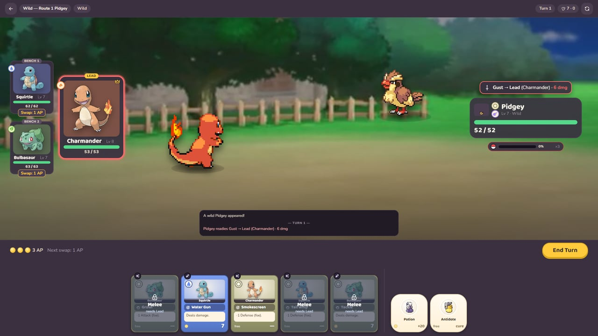
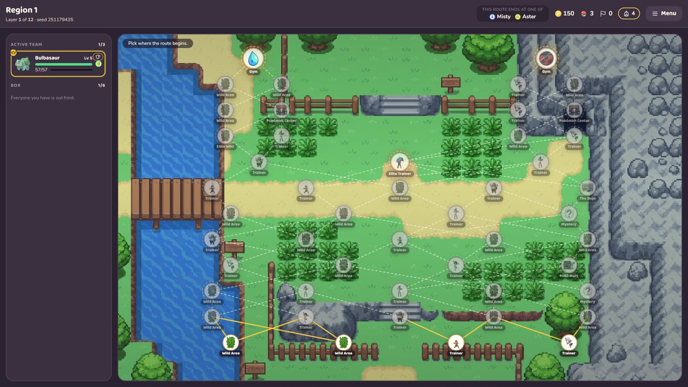

# Pokémon Ascendant

A roguelike deckbuilder where **your party is your deck**.

**▶ Play it in the browser: https://montuuh.github.io/Pokemon-Ascendant/**

> Unofficial, free, non-commercial fan project. Not affiliated with, endorsed by or connected to Nintendo,
> Creatures Inc., GAME FREAK inc. or The Pokémon Company. Pokémon and all related marks are their trademarks.



## How a fight works

- **Three active Pokémon, four moves each — that is your twelve-card deck.** You draw five skill cards and two
  item cards a turn and have **3 action points** to spend them with.
- **One of the three is the Lead.** It takes every single-target hit. **Melee** cards can only be played by the
  Lead; **Ranged** cards can be played from the bench.
- **Swapping the Lead is never free.** The first swap of a turn costs 1 AP, the second 2, the third 3. Some
  moves step a Pokémon forward or back as part of their effect — those are the swaps you *want*.
- **Every enemy move is telegraphed.** You see what it will do, to which slot, for how much, before you commit
  a card. The game is about answering what you can see, not gambling on what you cannot.
- Statuses, stat stages, type matchups and critical hits work the way you expect from the series. Gym Leaders
  and Elite fights have **multi-phase aces** that change behaviour at HP thresholds. Wild Pokémon can be
  **caught** — the gauge is deterministic, and a caught Pokémon joins your Box mid-run.



## How a run works

- **Region 1 is twelve layers of nodes** — wild fights, trainers, an Elite Trainer, a Pokémon Centre, a Poké
  Mart, a Dojo, Mystery Events, and sometimes an Elite Wild you can catch or defeat but not both.
- **The route forks.** Two of the Region's four Gyms are drawn per run and named on the map from the first
  node. The path splits at layer 8 into two lanes that never rejoin, and each lane *looks like* its Gym for four
  layers — caves and Hikers on the way to the Rock Gym, rivers and Swimmers on the way to the Water Gym. Plan in
  the trunk, commit at the fork.
- **Your Box holds six Pokémon; three are active.** Recruit from wild fights, choose who fights before each
  node, and decide who leaves when the Box is full.
- **Evolution is a choice.** At the threshold you pick an **archetype** — Vanguard, Specialist or Support — and
  the branch rewrites part of that Pokémon's four cards. The same species can become a different fighter every
  run.
- **A fainted Pokémon comes back, marked.** Each faint adds a stack of **Trauma** that lowers max HP until a
  Centre treats it. Money buys items, tutor moves, therapy — and never quite enough of all three.
- **Relics** are run-long passives; **held items** are one-per-Pokémon; a **Region Modifier** chosen at the start
  changes one rule for the whole Region; beating the Gym wins a **Badge** and a **1-of-3 Legendary relic**.
- **The account outlives the run.** Every fight, recruit and Badge pays **Trainer XP**; each level hands out
  something on a 30-row track — starters, relics, Hub conveniences, **Tokens** for the Poké Mart's Tier-3 lane.
  The **Pokédex** turns fights into knowledge: fight a species enough and its intents are revealed, your own
  copies turn shiny, and its line earns a fifth card. Twenty-four achievements so far.

## Status

**v0.9.106 — Moves on the Pokémon.** Moves the GBA plays on the Pokémon itself move its sprite — Agility's afterimages, Harden's metallic shine, Growth's swelling, Minimize's shrinking, Splash's hop — instead of generic rings. Before it, **v0.9.105 — Moves you can see.** A move's sprites are drawn bigger — embers, stars and orbs read across the stage — while jaws and barriers close within their target's card, and damage numbers keep a thicker outline. Before it, **v0.9.104 — Moves that move like the GBA.** Each FireRed move replays its own battle animation sprite by sprite — Flamethrower's embers in a wave, Fire Spin's circling the foe, Rock Throw's rocks falling — and the Gen IV moves borrow the one they move like. Before it, **v0.9.103 — The move, not the template.** Each move's own GBA sprites are its whole picture — no charge glow, rings or tint drawn over them — Bite, Cut and Slash land from where their user stands, and Protect, Amnesia, Sunny Day and Rock Tomb are drawn right. Before it, **v0.9.102 — Moves in their own sprites.** Every move is animated with FireRed / LeafGreen's own battle-animation sprites — Flamethrower's embers, Bite's jaws, Mega Kick's foot — with the GBA's backgrounds washing the stage for the big ones, and the Gen IV moves built from the same sprites. Before it, **v0.9.101 — Rooms with life.** Every FireRed-style room — the Pokémon Center, the Poké Mart and the Department Store, the Dojo, the Game Corner and the Trainer Hub — is redrawn from the games' own tiles and furnished for what it does, with Chansey at the Therapy beds, customers in every shop aisle, Machop and Machoke sparring in the Dojo and the League's trainers in the Hub. Before it, **v0.9.100 — Rocket offices.** The Black Market is Team Rocket's offices, drawn in FireRed's own tiles — desks, crates, server cabinets and Rocket banners — and the Executive has a private office of his own, with the Legendaries on show; a TM's tooltip explains its move, and locked and newly learned moves have tooltips too. Before it, **v0.9.99 — Commons first.** Common relics turn up often — route trainers drop them again and the Starting Relic is one — the Elite, the first Gym and the Elite Wild offer Uncommons rather than Rares, and Rares are the optional, dear or late prizes; still two Legendaries a run at most. Relic unlocks are off for now: every relic can turn up from your first run. Before it, **v0.9.98 — Rarity by power.** A relic's rarity now matches how strong it is: the weakest moved down a rarity (six Uncommons to Common, five Rares to Uncommon, four Legendaries to Rare) and Wide Lens moved up, so a Gym's Legendary pick holds only the six strongest relics in the game. Before it, **v0.9.97 — Relics rebalanced.** Every relic works as written — Steady Aim, Recycle Tag, Cycle Cell and Grandmaster's Tempo now fire, and Phoenix Feather returns once per Region — and rarity says how strong a relic is: Choice Band and Specs and Sage's Tome are toned down, the Legendaries hit harder, the weakest relics are reworked, and a Type Gem is offered only for a type your team uses. Before it, **v0.9.96 — The series' formulas.** Stats and damage follow the games' Gen III formulas: frail and sturdy Pokémon stand closer at low level, a level counts as it does in the games, and every hit that is not immune does something. Starters begin with a third move, the Region 1 walls learn an attack of their own type early, and while your starter is alone its first catch is sure. Before it, **v0.9.95 — Enemies at full strength.** Every enemy hits as its species and level say, with no hidden multipliers; route trainers stand at your level and Gym aces two over; trainers pay less XP; and a lone starter meets no wild Pokémon strong against its type. Before it, **v0.9.94 — No early walls.** In Region 1, no Rock, Steel or Ghost wild Pokémon turn up until your team knows an attack of its own type; the Wild Area's card shows the pool as it stands. Before it, **v0.9.93 — The series' scale.** Stats are printed at half scale, close to the games' own (a Lv 50 Pokémon has about 90 HP and 96 Attack); damage scales with them, so fights last as long as before, and Potions heal 10 / 30 / 60. Before it, **v0.9.92 — Enemies with intent.** Trainers carry five moves and Gyms and the League six, by role: a heavy hit, a set-up, a trick and a defence, from their trainer's repertoire. The tricks — Taunt, Disable, Roar, Mean Look, Yawn, Perish Song, Leech Seed, Spikes and Stealth Rock — show on the intent before they land, and most are answered by a swap. Enemies act twice far more often, and every Gym and League ace shows its combo's finisher a turn ahead: break it with a quarter of its HP or a super-effective hit. The Gym teams are forms they could be at their levels. Before it, **v0.9.91 — Moves that grow.** Every stage learns its own moves by level, from the series' Gen IV lists, and a move grows like the Pokémon: a new one takes an old one's slot — Scratch becomes Fire Fang, Fire Spin becomes Flamethrower — so no final form keeps Tackle, Scratch or Growl. The level-up window shows each step, and the Move Reminder in the Move Manager gives a replaced move back for free. 76 more moves from Gen II–IV: the elemental fangs, Shadow Ball, Dragon Claw, X-Scissor, Sludge Bomb and more. Before it, **v0.9.90 — Real evolution levels.** Pokémon evolve at the series' own levels — the starters at 16 and 36, Dratini at 30 and Dragonair at 55 — so each member of the team evolves at its own moment. Stone lines evolve only by their stone; the trade evolutions level up holding their own item (the Twisted Spoon for Kadabra, a Macho Brace, Hard Stone, Spell Tag or Metal Coat), spent on evolving; and the shops always carry what an evolution is waiting on. A new Friendship shows as five hearts on each Pokémon: it grows with wins, levels and the Center's grooming, evolves Eevee into Umbreon, powers Return and, at its top, holds a Pokémon on at 1 HP once a fight. Before it, **v0.9.89 — Move keywords.** Moves do more than hit: Protect, Endure, Guard, Substitute, Reflect and Light Screen guard a side; Recover, Wish, Synthesis and Ingrain heal with PP each fight; Rain Dance, Sunny Day, Sandstorm and Hail set the weather for three turns, and Thunder is cheaper in the rain. No card costs more than 3 AP: Hyper Beam and the starter ultimates recharge, Fire Blast and Blizzard leave you an AP short next turn, Overheat and Close Combat drop your own stats; Solar Beam and Fly land next turn, Counter returns a hit. 38 moves from Gen II–IV and 13 TMs; an enemy's Protect or screen is up the moment it is declared. Before it, **v0.9.88 — Authored Gym teams.** Every Gym Leader fields five distinct Pokémon of their own with four authored moves each — no repeats, no lane filler. Brock, Aster and Lorelei bring one declared off-type guest, named on the map before the fork and in the Team matchups; Lorelei's ace is Lapras. A map saved before keeps the Gym it promised. Before it, **v0.9.87 — Readable boss phases.** A crossed threshold shows as "1/3 → 2" and starts next turn; healing never undoes it; each three-phase ace declares one authored, always-visible signature with its answer; your rhythm ring fills when the card lands. Before it, **v0.9.86 — AP, evolution and Center choices.** Sage's Tome grants AP from turn one, capped at 6; every AP change is explained in the combat console. Postpone evolution and resume from the Team sheet. The Center offers manual nurse healing, Therapy beds and a whole-Box HP/Trauma panel; Daycare is removed. Before it, **v0.9.85 — Equipment and bounded control.** Safari rewards the first catch with equipment; trainers and shops offer more useful Held Items. Sleep/Freeze cannot be chained through replacement, Confusion fumbles only its owner's cards and expires on enemies, and Paralysis charges both enemy actions. Before it, **v0.9.84 — Dark and Steel.** Two new types join the chart with the Pokémon, moves and items that carry them: Umbreon (Eevee's fourth path), Scizor, Steelix and Magnezone; Magnemite is Electric/Steel; Bite is Dark; fourteen new Dark and Steel moves; Dark and Steel Gems, Black Glasses, two Plates and a Metal Coat. Before it, **v0.9.83 — See the ring.** A card's hover says how much of its owner's critical-rhythm ring it fills, the ring previews it as a ghost arc while the card is held, a ▲ / ▼ marks a Speed change, and a short cue sounds when a ring fills. Before it, **v0.9.82 — Worth its AP.** Your critical rhythm fills by the AP your cards cost: a big card feeds it more, a free card nothing, and a swap's AP none. Before it, **v0.9.81 — Pace.** The critical rhythm is a continuous meter: Speed stages and Paralysis change how fast it fills, as it happens; Agility gives +2 Speed, String Shot, Constrict and Bubble Beam slow the foe; the dial's hover says which Speed it reads. Before it, **v0.9.80 — Every level counts.** The first Gym offers a Rare and two Uncommons instead of three Rares; Flow State makes the first swap of every turn free (it was the Tactician's Coin twice); the Apex Reveal is on the Mart's shelf and names Victory Road's Legendary on entering Region 3; the result screen shows one panel per level and waits for a click when a level teaches a move; the ten fastest enemies crit every second action, the very slowest every fifth. Before it, **v0.9.79 — At a glance.** The rest of the Mystery Event scenes name themselves before their title: a statue shrine, a pen with a Pikachu resting in it, a bather in the hot spring, glints on the stone and the ball, a question mark over the lost pack. No rule change. Before it, **v0.9.78 — Told by the picture.** Four Mystery Event scenes lead with their one prop at full size — the carny's coin, the Ranger's opened kit, Eevee's three stones, a lone mossy rock — so the event reads before its title. No rule change. Before it, **v0.9.77 — One visit.** The Training Grounds and the field nurse are single scenes: the picked Pokémon stands on the coach's mat with Train under it, Train hops and says what it did before the road, and the nurse's total sits under her scene. No rule change. Before it,
**v0.9.76 — Plates on the rim.** The Ring's rungs are one-line plates — number and prize — on each platform's rim instead of placards over it, and none is cut off at 720p with large text. No game change. Before it,
**v0.9.75 — A real crowd.** The Coliseum's spectators are six different Emerald NPCs — some in profile — with uneven gaps and empty seats instead of a tiled strip, and nobody sits behind a court. No game change. Before it,
**v0.9.74 — The instructions too.** `CLAUDE.md`, the project's instructions to Claude Code, is versioned beside `.claude/`, so a cloud session starts from the same rules. No game change. Before it,
**v0.9.73 — The workshop in the repo.** `.claude/` — the skills, agents, rules, hooks and settings the work runs on — is versioned, so a cloud session has them; a session's own state (review queue, stamps, handoff patches) stays local. No game change. Before it,
**v0.9.72 — Room to point.** A lane's weather tag is a label that never takes a node's click, placed clear of the captions; the UI audit now flags any control whose centre belongs to something else, and `npm run ui:film` records a beat in real time as a contact sheet. Before it,
**v0.9.71 — Settled pictures.** The Summit layout e2e waits for each picture to load or fail before counting broken ones; under load it counted an offer still loading. No game change. Before it,
**v0.9.70 — Same map every run.** A run started from the menu takes a deep link's seed (`/?screen=menu&seed=7`), so the e2e that walk the new-run steps meet the same map every time; the suite runs four workers. No game change for a player. Before it,
**v0.9.69 — Heads and captions.** The route no longer cuts its top row's heads or its bottom row's captions at 720p: more ground above the first row when a node stands in it, a board that always fits its height, and the lower lane's weather tag on the split, clear of the captions. Before it,
**v0.9.68 — The blow, then the faint.** The combat log names the hit before the faint it caused, for your moves and the foes'. Before it,
**v0.9.67 — The contact frame.** HP bars empty at the series' constant rate and a faint waits for its bar; a super-effective, critical or knockout blow holds the contact frame for a beat; a played card leaves toward its target; buttons give under a press and modals and sheets grow in. Before it,
**v0.9.66 — Hits with weight.** The motion sweep: a routine hit recoils, a super-effective or critical one shakes, the blow that faints jolts the stage; under reduced motion the numbers hold and fade and the banners stay still; the hand hovers faster and tooltips open at once as you read across it. Before it,
**v0.9.65 — Four stale checks.** The last three stale e2e checks fixed: the Dojo expects no practice effect under reduced motion, the Potion test finds a refused row by `aria-disabled`, and the route caption check measures each image once instead of timing out. No game change. Before it,
**v0.9.64 — Five cards again.** Two stale end-to-end checks fixed: the ✦ crit badge no longer counts as a sixth card in hand, and the victory check finds Regions behind the Run record door. No game change. Before it,
**v0.9.63 — Reduced motion, both ways.** Settings → Motion wins over the device both ways: Reduce stops transitions, pulses and breathing, and Full brings shakes and loops back even when the device asks for less. Before it,
**v0.9.62 — Motion review.** Animations pass the UI review too: menus are held to quick, responsive motion, combat beats to the weight of each event, and the audit flags motion that reduced-motion settings would miss. Before it,
**v0.9.61 — One crit mark.** Every card that will crit — AlwaysCrit or a full rhythm — wears the same ✦. Before it,
**v0.9.60 — The rhythm dial.** Each card's critical rhythm is a dial on its edge, and a card about to crit says so in your hand. Before it,
**v0.9.59 — Critical rhythm.** Every Pokémon crits its next hit after a few acts, sooner the faster it is; an enemy's crit is shown as CRIT on its intent. Swaps are 1 AP cheaper on every rung for a Pokémon faster than the enemy Lead. Before it,
**v0.9.58 — Speed matters.** The turn's first swap is free for a Pokémon faster than the enemy Lead, Paralysis halves Speed, and every portrait names its Speed. Before it,
**v0.9.57 — Clear trade comparison.** The Trader groups outgoing and incoming Pokémon, levels and condition around an explicit confirmation. Offers respect reduced motion. Before it,
**v0.9.55 — Room for every reward.** Gym Badges and level-up windows have separate space at large text sizes. Run records retain every cleared region after Victory Road and League defeats. Before it,
**v0.9.54 — The field after.** A fight now ends on its own stage: your team stays where it stood while its HP and XP bars fill with the series' sounds, a level-up plays its fanfare and stat window, the trainer you beat steps forward (a Gym's Badge in its case), and the spoils are dealt into the tray — one click on. Evolutions arrive as a surprise. Before it,
**v0.9.53 — Basement service bays.** Quiet slate aisles and warm service areas give the hidden market a clearer focus, with original FRLG stock props. Before it,
**v0.9.52 — Summit decisions at large text.** Wider relic offers keep both gate choices visible at 150% text. The League preview sits beneath the arrival scene. Before it,
**v0.9.51 — Compact Center reception.** Healthy visits centre the room with one compact status. Healing keeps its adjacent, scrollable report and readable large-text cards. Before it,
**v0.9.41 — Readable patch labels.** Higher-contrast patch versions in What's new, retaining pixel numerals. Before it,
**v0.9.40 — Places worth reading.** Responsive route artwork and hover cards, clear captions, final-team portraits and verified art records. Before it,
**v0.9.30 — Gen II type chart.** The 15-type chart now uses Generation II effectiveness: Ghost hits Psychic for ×2, Fire resists Ice at ×0.5, Bug hits Poison for ×0.5, and Poison hits Bug neutrally at ×1. Before it,
**v0.9.29 — Who lives there.** Each Wild Area on the map now shows its habitat in front with two of its Pokémon at
its sides, and they go round the whole pool as you look, so the board tells you who lives where. Before it,
**v0.9.28 — The map, at a glance.** A Wild Area on the map is now its habitat alone — the Pokémon Tower, a cave, a
volcano, a reef — standing in the same grass; every node's chip is a rounded plate with an icon, and the nodes you can
go to next wear theirs as a gold button you can click. The team panel on the route only shows the team now (the Team
screen changes it), and closing the Move Manager no longer closes the Team screen with it. Before it,
**v0.9.27 — Landmarks.** Every Wild Area on the map shows where it is: its Pokémon stands in the same tall grass
everywhere, with its habitat's landmark rising behind it — the Pokémon Tower's dome, the Power Plant, a cave's mouth, a
volcano, a Tanoby chamber, a reef — all FireRed's own pixels. And the Labels toggle names each node by its kind: Wild,
Trainer, Elite Trainer, Nurse, and each Gym with its Leader. Before it,
**v0.9.26 — The team, managed.** One Team screen wherever the team is chosen — on the map (or with T), in a City's
lobby, at its Center: the formation as it will fight and the Box beside it, moved by dragging or by a button, and the
sheet of the Pokémon you pick — its stats, its ability, the item it holds, its cards, its evolution, and how it meets
the Gyms your route ends at. Before it,
**v0.9.25 — The route, reworked.** Wild Areas are habitats now — Tall Grass, a Forest, a Fishing Spot, a Rocky Ridge,
the Power Plant, an Old Tower and more, each a pool of one family with its own backdrop — so where you look is a plan.
A find on the path is an item ball whose reel of seven prizes spins as you pick it up, relics among them; the Pokémon
Center runs its healing machine to its jingle and every bar says what came back; the Elite and the Gyms stand over
your team instead of under it; and a Labels toggle names every node on the map. Before it,
**v0.9.24 — Move animations.** Every move now plays out across the field: a Pokémon dashes over to tackle and
comes back, a fireball or a spray of bubbles flies from one side to the other, Hydro Pump is a beam and Thunderbolt a
bolt, and Surf rolls a wave across the whole screen while Earthquake splits the floor and shakes it — the damage
landing as the move does. Before it,
**v0.9.23 — Sound.** The game is no longer silent: every sound is synthesised as it plays, with no recordings —
each card type has its own whoosh, hits land by how effective they were, the Poké Ball wobbles and clicks, and the
music follows you from Region to Region, through the Cities, up Victory Road and into the League, pressing on when
your team runs low. Music and Effects volumes are in Settings. Before it,
**v0.9.22 — The League.** Through the Summit's gate the run reaches the Pokémon League: five doors in a row —
Bruno, Agatha, Will and Lance of the Elite Four, each on their own type's ground, then Champion Blue with the starter
that beats yours and a team that hits harder for every ally that falls. Between doors, everyone standing gets a little
HP back; beat the Champion and the run is won. Before it,
**v0.9.21 — The Legendaries.** Articuno, Zapdos, Moltres, Mewtwo and Mew join the run. One waits at the top of
Victory Road in its own arena — Mewtwo's Barrier in Cerulean Cave, Moltres rising again on Mt. Ember, Mew changing the
field every turn — to be caught, or beaten for a Legendary relic; Team Rocket's Executive sells one for three of your
Pokémon. A Legendary fills two of the team's three places with one body: strong, and only one partner to swap to.
Before it,
**v0.9.20 — Victory Road.** After the third Gym the run climbs one last road before the League: three tracks of
Region 3's strongest, Ace Trainers in Gauntlets that give back no healing and pay a Rare relic (and, won with nobody
fainting, a Badge the run passed by), Training Grounds where one Pokémon takes one upgrade, and the Summit, which
heals everyone and offers a Legendary relic before its gate — for now, the run is won there. Before it,
**v0.9.19 — The route Trader.** On about half the routes a Poké Fan waits by the road: give one of your Box and pick
one of three face-down offers, each showing a type and the level it arrives at — two above the one you gave — and the
species is the surprise. Before it,
**v0.9.18 — Fights with another objective.** Some fights are won by something else: a runner — an Abra, a Meowth,
a Chansey — that gets away after a turn or two unless you knock it out first for its premium or catch it, and a
guarded find you win by holding out to the last turn against a guard that hits harder every turn. Both are named on
the map and counted down in the fight. Before it,
**v0.9.17 — The title screen, a battle.** Behind the title and the new-run steps, a Pokémon battle plays by itself
— famous matchups like Charizard and Venusaur or Pikachu and Gyarados trading their own moves on the game's battle
backdrops, the move's picture landing, a bar draining, one fainting and the next coming in — under a title mark of
the game's own, and the starters stand in their cards as the fights draw them. Before it,
**v0.9.16 — The arena, one formation.** Every Pokémon on the field is a card with its animated sprite in a window —
your three in formation on the left, the Lead centred between its bench, the enemy mirrored on the right and tagged
Lead, Bench 1 and Bench 2 like yours — an arrow in the intent's colour from each enemy to the Pokémon it will hit, the
HP about to go striped on the bar, the rival trainer behind its line-up with its team as Poké Balls; cards are dragged
whole and played only onto a target, and the AP capsule shows what a card would spend before it is played. Before it,
**v0.9.15 — The combat screen and its cards.** Every move card shows the move itself — a pixel illustration for each
of the 161 Gen I moves, which also lands on the Pokémon it hits — with its owner in the corner, a clearer cost and
power, and locks that keep the card readable; the item cards match, the tray is one row, the battle log is a ticker in
the top bar and your team is drawn in the arena's own pixels. Before it,
**v0.9.14 — The map, redrawn.** The route is drawn the way Pokelike draws its map: straight diagonal lines from node
to node instead of right-angled roads, each node drawn as what waits there — the trainer, the Gym Leader, the Pokémon
peeking out of the grass, the item on the ground — and the routes you can no longer take faded. Before it,
**v0.9.13 — The Gym Leaders, on stage and by their own rule.** Each of the twelve Gym Leaders fights under a rule
of its own — Brock's wall that only chips, Misty's riptide that swaps your Lead, Sabrina's seal on your best card —
shown on the map and the fight's top bar, and the Leader stands behind its Pokémon for the whole fight. Before it,
**v0.9.12 — Whole enemies, and the double intent.** Enemies fight on the HP their species and level give, every hit
lands harder, and Ace Trainers, Rare wild Pokémon and Gym aces act twice — a combo you can break. Before it,
**v0.9.11 — Moves for every path, and the faint that fades.** Every evolved Pokémon learns its line's signature
moves as it levels, so no evolution path ends with a weak kit; a fainted foe fades out in its place. Before it,
**v0.9.10 — Combat, stats and moves, revisited.** The Pokémon behind an enemy Lead fights whole, stats grow in the
series' proportions, 46 TMs and a Dojo that remembers bring the lost moves back, and fewer, bigger relics.

## Run it locally

```bash
npm install
npm run dev        # http://localhost:5173
```

```bash
npm run check      # typecheck, lint, ~490 unit tests, design-doc and version guards
npm run e2e        # ~70 Playwright tests, including a full run played through the UI
npm run balance    # auto-player win rates per starter
```

Node ≥ 20. Playwright uses the system Chrome.

## Under the hood

TypeScript · React 19 · Vite · Vitest · Playwright · Zustand · Zod. The simulation in `src/sim` is pure and
deterministic — a seed and an input log replay a fight identically, which is what the golden-master tests and
the balance harness are built on. The UI is a view over it.

| | |
|---|---|
| [`docs/design/`](docs/design/) | The design canon — ten topics, every rule stated once. Code cites it by section (`§3.3.1`) and a guard proves every citation resolves. |
| [`docs/design/catalogs/`](docs/design/catalogs/) | Every species, move, relic, item, trainer and event, authored here first. |
| [`docs/architecture.md`](docs/architecture.md) | How the code is organised and why. |
| [`docs/art/pipeline.md`](docs/art/pipeline.md) | Where each asset comes from. Pokémon, items, badges and backdrops are the real ones; the two scenes are generated. |

Successor of *Project Ascendant*, a Unity build of the same design; the code was re-implemented for the web
where the iteration loop is fast. See [`docs/migration/from-unity.md`](docs/migration/from-unity.md).

## Licence

The code, design documents and original assets are **MIT** — see [`LICENSE`](LICENSE). The Pokémon material is
not covered by that licence and is not mine to license: it is © Nintendo / Creatures Inc. / GAME FREAK inc.,
included on non-commercial fan-work terms, and itemised in [`docs/art/ATTRIBUTION.md`](docs/art/ATTRIBUTION.md).
