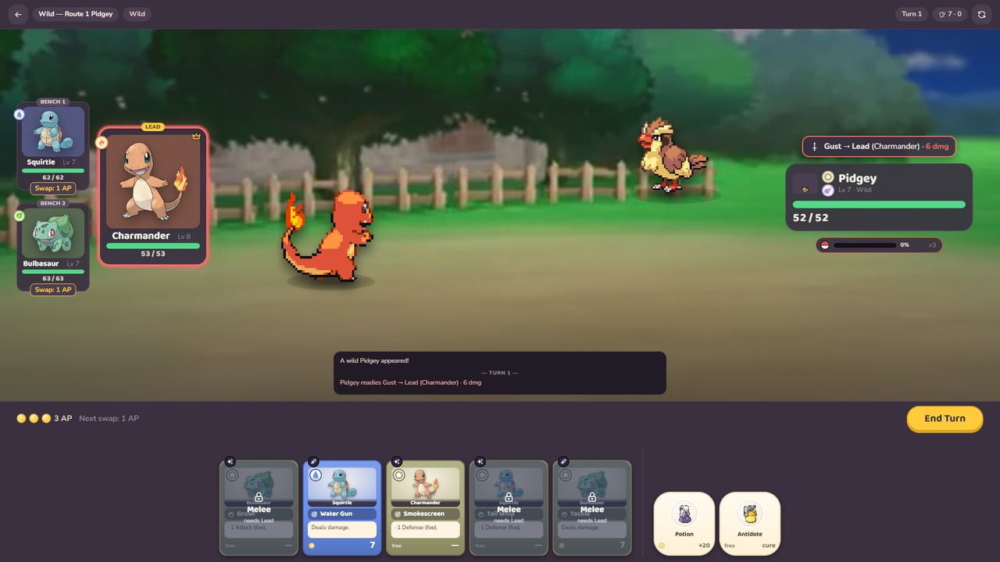
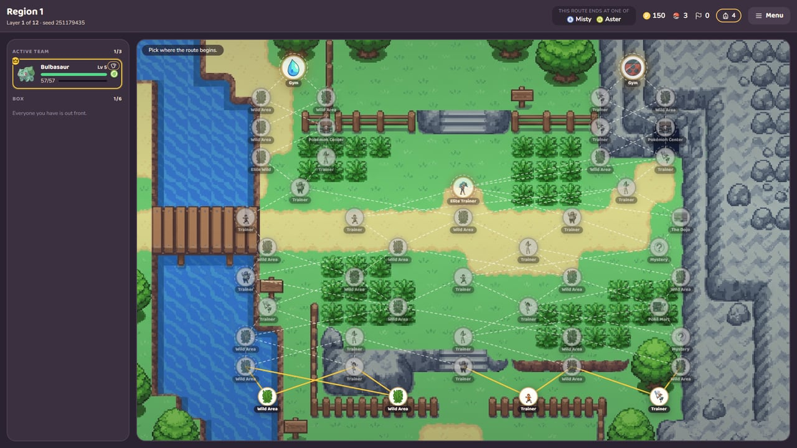

# Pokémon Ascendant

A roguelike deckbuilder where **your party is your deck**.

**▶ Play it in the browser: https://montuuh.github.io/Pokemon-Ascendant/**

> Unofficial, free, non-commercial fan project. Not affiliated with, endorsed by or connected to Nintendo,
> Creatures Inc., GAME FREAK inc. or The Pokémon Company. Pokémon and all related marks are their trademarks.



## How a fight works

- **Three active Pokémon, four moves each — that is your twelve-card deck.** You draw five skill cards and two
  item cards a turn and have **3 action points** to spend them with.
- **One of the three is the Lead.** It takes every single-target hit. **Melee** cards can only be played by the
  Lead; **Ranged** cards can be played from the bench.
- **Swapping the Lead is never free.** The first swap of a turn costs 1 AP, the second 2, the third 3. Some
  moves step a Pokémon forward or back as part of their effect — those are the swaps you *want*.
- **Every enemy move is telegraphed.** You see what it will do, to which slot, for how much, before you commit
  a card. The game is about answering what you can see, not gambling on what you cannot.
- Statuses, stat stages, type matchups and critical hits work the way you expect from the series. Gym Leaders
  and Elite fights have **multi-phase aces** that change behaviour at HP thresholds. Wild Pokémon can be
  **caught** — the gauge is deterministic, and a caught Pokémon joins your Box mid-run.



## How a run works

- **Region 1 is twelve layers of nodes** — wild fights, trainers, an Elite Trainer, a Pokémon Centre, a Poké
  Mart, a Dojo, Mystery Events, and sometimes an Elite Wild you can catch or defeat but not both.
- **The route forks.** Two of the Region's four Gyms are drawn per run and named on the map from the first
  node. The path splits at layer 8 into two lanes that never rejoin, and each lane *looks like* its Gym for four
  layers — caves and Hikers on the way to the Rock Gym, rivers and Swimmers on the way to the Water Gym. Plan in
  the trunk, commit at the fork.
- **Your Box holds six Pokémon; three are active.** Recruit from wild fights, choose who fights before each
  node, and decide who leaves when the Box is full.
- **Evolution is a choice.** At the threshold you pick an **archetype** — Vanguard, Specialist or Support — and
  the branch rewrites part of that Pokémon's four cards. The same species can become a different fighter every
  run.
- **A fainted Pokémon comes back, marked.** Each faint adds a stack of **Trauma** that lowers max HP until a
  Centre treats it. Money buys items, tutor moves, therapy — and never quite enough of all three.
- **Relics** are run-long passives; **held items** are one-per-Pokémon; a **Region Modifier** chosen at the start
  changes one rule for the whole Region; beating the Gym wins a **Badge** and a **1-of-3 Legendary relic**.
- **The account outlives the run.** Every fight, recruit and Badge pays **Trainer XP**; each level hands out
  something on a 30-row track — starters, relics, Hub conveniences, **Tokens** for the Poké Mart's Tier-3 lane.
  The **Pokédex** turns fights into knowledge: fight a species enough and its intents are revealed, your own
  copies turn shiny, and its line earns a fifth card. Twenty-four achievements so far.

## Status

**v0.9.24 — Move animations.** Every move now plays out across the field: a Pokémon dashes over to tackle and
comes back, a fireball or a spray of bubbles flies from one side to the other, Hydro Pump is a beam and Thunderbolt a
bolt, and Surf rolls a wave across the whole screen while Earthquake splits the floor and shakes it — the damage
landing as the move does. Before it,
**v0.9.23 — Sound.** The game is no longer silent: every sound is synthesised as it plays, with no recordings —
each card type has its own whoosh, hits land by how effective they were, the Poké Ball wobbles and clicks, and the
music follows you from Region to Region, through the Cities, up Victory Road and into the League, pressing on when
your team runs low. Music and Effects volumes are in Settings. Before it,
**v0.9.22 — The League.** Through the Summit's gate the run reaches the Pokémon League: five doors in a row —
Bruno, Agatha, Will and Lance of the Elite Four, each on their own type's ground, then Champion Blue with the starter
that beats yours and a team that hits harder for every ally that falls. Between doors, everyone standing gets a little
HP back; beat the Champion and the run is won. Before it,
**v0.9.21 — The Legendaries.** Articuno, Zapdos, Moltres, Mewtwo and Mew join the run. One waits at the top of
Victory Road in its own arena — Mewtwo's Barrier in Cerulean Cave, Moltres rising again on Mt. Ember, Mew changing the
field every turn — to be caught, or beaten for a Legendary relic; Team Rocket's Executive sells one for three of your
Pokémon. A Legendary fills two of the team's three places with one body: strong, and only one partner to swap to.
Before it,
**v0.9.20 — Victory Road.** After the third Gym the run climbs one last road before the League: three tracks of
Region 3's strongest, Ace Trainers in Gauntlets that give back no healing and pay a Rare relic (and, won with nobody
fainting, a Badge the run passed by), Training Grounds where one Pokémon takes one upgrade, and the Summit, which
heals everyone and offers a Legendary relic before its gate — for now, the run is won there. Before it,
**v0.9.19 — The route Trader.** On about half the routes a Poké Fan waits by the road: give one of your Box and pick
one of three face-down offers, each showing a type and the level it arrives at — two above the one you gave — and the
species is the surprise. Before it,
**v0.9.18 — Fights with another objective.** Some fights are won by something else: a runner — an Abra, a Meowth,
a Chansey — that gets away after a turn or two unless you knock it out first for its premium or catch it, and a
guarded find you win by holding out to the last turn against a guard that hits harder every turn. Both are named on
the map and counted down in the fight. Before it,
**v0.9.17 — The title screen, a battle.** Behind the title and the new-run steps, a Pokémon battle plays by itself
— famous matchups like Charizard and Venusaur or Pikachu and Gyarados trading their own moves on the game's battle
backdrops, the move's picture landing, a bar draining, one fainting and the next coming in — under a title mark of
the game's own, and the starters stand in their cards as the fights draw them. Before it,
**v0.9.16 — The arena, one formation.** Every Pokémon on the field is a card with its animated sprite in a window —
your three in formation on the left, the Lead centred between its bench, the enemy mirrored on the right and tagged
Lead, Bench 1 and Bench 2 like yours — an arrow in the intent's colour from each enemy to the Pokémon it will hit, the
HP about to go striped on the bar, the rival trainer behind its line-up with its team as Poké Balls; cards are dragged
whole and played only onto a target, and the AP capsule shows what a card would spend before it is played. Before it,
**v0.9.15 — The combat screen and its cards.** Every move card shows the move itself — a pixel illustration for each
of the 161 Gen I moves, which also lands on the Pokémon it hits — with its owner in the corner, a clearer cost and
power, and locks that keep the card readable; the item cards match, the tray is one row, the battle log is a ticker in
the top bar and your team is drawn in the arena's own pixels. Before it,
**v0.9.14 — The map, redrawn.** The route is drawn the way Pokelike draws its map: straight diagonal lines from node
to node instead of right-angled roads, each node drawn as what waits there — the trainer, the Gym Leader, the Pokémon
peeking out of the grass, the item on the ground — and the routes you can no longer take faded. Before it,
**v0.9.13 — The Gym Leaders, on stage and by their own rule.** Each of the twelve Gym Leaders fights under a rule
of its own — Brock's wall that only chips, Misty's riptide that swaps your Lead, Sabrina's seal on your best card —
shown on the map and the fight's top bar, and the Leader stands behind its Pokémon for the whole fight. Before it,
**v0.9.12 — Whole enemies, and the double intent.** Enemies fight on the HP their species and level give, every hit
lands harder, and Ace Trainers, Rare wild Pokémon and Gym aces act twice — a combo you can break. Before it,
**v0.9.11 — Moves for every path, and the faint that fades.** Every evolved Pokémon learns its line's signature
moves as it levels, so no evolution path ends with a weak kit; a fainted foe fades out in its place. Before it,
**v0.9.10 — Combat, stats and moves, revisited.** The Pokémon behind an enemy Lead fights whole, stats grow in the
series' proportions, 46 TMs and a Dojo that remembers bring the lost moves back, and fewer, bigger relics.

## Run it locally

```bash
npm install
npm run dev        # http://localhost:5173
```

```bash
npm run check      # typecheck, lint, ~490 unit tests, design-doc and version guards
npm run e2e        # ~70 Playwright tests, including a full run played through the UI
npm run balance    # auto-player win rates per starter
```

Node ≥ 20. Playwright uses the system Chrome.

## Under the hood

TypeScript · React 19 · Vite · Vitest · Playwright · Zustand · Zod. The simulation in `src/sim` is pure and
deterministic — a seed and an input log replay a fight identically, which is what the golden-master tests and
the balance harness are built on. The UI is a view over it.

| | |
|---|---|
| [`docs/design/`](docs/design/) | The design canon — ten topics, every rule stated once. Code cites it by section (`§3.3.1`) and a guard proves every citation resolves. |
| [`docs/design/catalogs/`](docs/design/catalogs/) | Every species, move, relic, item, trainer and event, authored here first. |
| [`docs/architecture.md`](docs/architecture.md) | How the code is organised and why. |
| [`docs/art/pipeline.md`](docs/art/pipeline.md) | Where each asset comes from. Pokémon, items, badges and backdrops are the real ones; the two scenes are generated. |

Successor of *Project Ascendant*, a Unity build of the same design; the code was re-implemented for the web
where the iteration loop is fast. See [`docs/migration/from-unity.md`](docs/migration/from-unity.md).

## Licence

The code, design documents and original assets are **MIT** — see [`LICENSE`](LICENSE). The Pokémon material is
not covered by that licence and is not mine to license: it is © Nintendo / Creatures Inc. / GAME FREAK inc.,
included on non-commercial fan-work terms, and itemised in [`docs/art/ATTRIBUTION.md`](docs/art/ATTRIBUTION.md).
