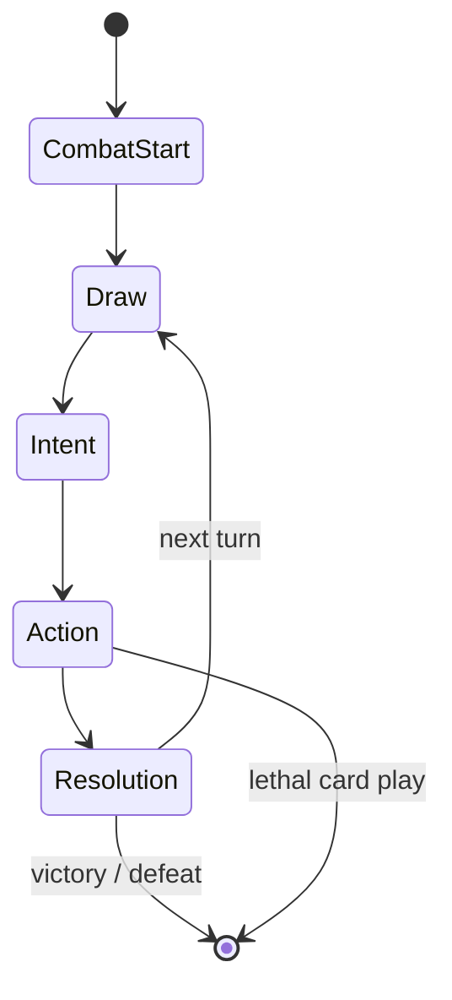

# Topic 3 — Combat

> **Canon.** `§` numbers are an API cited from code and tests — never renumber or delete a section.
>
> **This topic owns:** the shape of a fight — its five phases, the Lead mechanic, the deck, the hand, the consumable pile and the action economy. Everything **you** do on your turn.
> **It does not own:** what the numbers do (Topic 4) or what the enemy does (Topic 5).

---

# §3.1 What a combat is

A combat is an **atomic** event: it starts, it resolves, and it cannot be saved or left in the middle. It has
exactly two outcomes.

| Outcome | Condition |
|---|---|
| **Victory** | Every enemy is defeated — **or**, in a wild encounter, the wild Pokémon is caught (§2.6.4) |
| **Defeat** | All three Active Team Pokémon have fainted |

There is no draw. Both conditions are checked continuously: if a card played during the Action Phase kills the
last enemy, combat ends **immediately** and the enemy's telegraphed action never fires.

## §3.1.1 Ordering when both could happen at once

Inside the Resolution Phase, all damage, status ticks and faints resolve **first**, and only then are the
outcomes checked. If the last enemy and the player's last Pokémon fall in the same Resolution, **Defeat wins** —
the team is gone.

A catch ends combat as a Victory and awards **full** combat XP; it is never an XP penalty compared with a kill.

## §3.1.2 Running

A fight can be left, and leaving is never free. *(Decided 2026-09-21; the question had been open since v0.1.)*

**How.** *Run* is an action in the Action Phase, any turn, once the Lead pick — if one is pending — is made.
The enemy takes the action it has **telegraphed** first (the parting shot); if the team survives it, the fight
ends as **Escaped**: no XP, no drop, no catch, no reward screen. The node counts as walked and the next layer
opens. Then the run collects the toll, which climbs with the stakes of the fight you left:

| Fight | Money | Trauma | And |
|---|---|---|---|
| Wild | −20 % of the wallet | +1 on the Lead | — |
| Trainer | −30 % | +1 on every Active member | one random consumable is dropped |
| Elite Trainer · Elite Wild | −50 % | +1 on every Active member | one random relic is left behind (never a Legendary; a consumable if you hold no relic) |
| **Gym** | **cannot run** | | |

The toll is printed on the button before it is pressed (Pillar 1), and the parting shot is the intent you can
already see. What running buys is the rest of the run; what it costs is set so that it is cheaper than a wipe
and dearer than the win you gave up — a free exit would have devalued the swap decision Pillar 2 is built on,
and this is what makes it a decision instead of an undo. The Gym is exempt because the fork was the choice and
it was made (§2.5). Losing a *Pokémon* was considered for the Elite tier and rejected: a Pokémon carries its
levels and its Bond, and losing one reads as losing the run.

---

# §3.2 The five phases

Each turn cycles through five phases. Every phase emits an event so the UI, audio and relic hooks can react
without the simulation knowing they exist.

## §3.2.1 Combat Start (once)

- The Active Team locks. The **skill deck** is built from each Active Pokémon's active 4 moves — 12 cards
  baseline, up to 15 with Mastery Moves (§5.13.2).
- The **consumable pile** is built from the player's inventory.
- The Lead is the front slot of the Active Team, as ordered in the Map View.
- **Pokémon enter at their current HP.** There is no restoration on entering a fight (§2.4).
- Stat stages start clear. **Any status** a Pokémon ended its last fight with is still in effect from turn
  one, with what is left of its duration (§4.2.7.1).
- Any field effect for this encounter is set, including a boss's Home Field (§4.3.5).

## §3.2.2 Draw Phase

- Draw **5 skill cards** and **2 consumable cards**.
- Unspent AP expires, then AP refills to **3**, modified by relics, Badges, Region Modifiers and abilities.
  The refill, recurring bonuses (including Sage's Tome on turn 1), stored credits and restoration each obey the
  **6 AP cap** (§3.8). Apply base refill, enemy Tempo Control tax, recurring bonuses, stored credits, then abilities.
- The full combat log retains an AP ledger for every turn: each gain, expiry, spend and zero-cost action names its
  source and actual before → after balance. Cost entries expose printed cost, condition taxes, discounts and free
  effects. A capped gain states the amount blocked. Next-turn credits name their source when stored and when applied;
  storing them does not change current AP. Pure previews and forecasts never add entries.
- The swap counter resets to 0.
- Confusion discards resolve now (§4.2.3.1).

## §3.2.3 Intent Phase

Each enemy reveals **one** intent. An intent targets a **slot**, not a Pokémon — if it names the bench-left
slot, it hits whoever occupies that slot when Resolution fires.

The display always shows three things: the action type, its magnitude, and the targeted slot **with the name of
its current occupant**. Intent types and their rules: §4.3.2.

## §3.2.4 Action Phase

The player spends 3 AP on any mix of:

- **Skill cards** (0–3 AP; rare 4-AP ultimates exist and need setup to afford).
- **Consumables** (0–2 AP; see §3.5).
- **Manual Lead swaps** (1, then 2, then 3 AP within the turn — §3.3.1).

Card effects resolve **immediately** on play. Hand state is fully visible; hovering or dragging a card previews
its exact calculated damage against each enemy it can reach, including every multiplier (§4.1.1). Against a group
the card is aimed — dragged onto an enemy, or the card then the enemy clicked — and a single-target Melee card
reaches only the enemy Lead (§5.6).

Two restrictions define positional play:

- **Melee cards can only be played from the Lead**, unless the card carries Step-Forward.
- **Ranged cards can be played from any slot**, at 0.75× damage.

Cards are playable only from Pokémon that are in the Active Team and not fainted. The player ends the phase with
**End Turn**.

## §3.2.5 Resolution Phase

In order:

1. Enemies execute their telegraphed intents. With several enemies: supports first in slot order, the lead enemy
   last (§5.6).
2. Position-targeted intents land on whoever **currently** occupies the slot — not whoever was there when the
   intent was declared.
3. Status effects tick (§4.2).
4. Faints resolve (§3.3.5).
5. Outcomes are checked (§3.1.1).
6. The hand goes to the discard pile; used consumables are set aside until combat end; the turn ends.

---

# §3.3 The Lead mechanic

The Lead is the central tactical concept of the game. It answers two questions at once — *who takes the hit* and
*which cards come online* — and changing it always costs something.

## §3.3.1 Core rules

**Damage absorption.** The Lead takes 100 % of single-target enemy damage. The exceptions — Cleave (all slots)
and Backstrike (a named bench slot) — are always telegraphed in the Intent Phase.

**Manual swap cost.** Swapping escalates within a turn:

| Swap this turn | Cost | Quick swap (§3.3.1.1) |
|---|---|---|
| 1st | 1 AP | 0 AP |
| 2nd | 2 AP | 1 AP |
| 3rd | 3 AP | 2 AP |

The counter resets at the start of every turn. **Only manual swaps increment it** — Step-Forward, Step-Backward
and faint replacement do not.

### §3.3.1.1 Quick swap — what Speed is for

A Pokémon **faster than the enemy Lead** steps into the Lead for **1 AP less** on **every rung** (`quickSwapDiscount`,
floor 0): the 1 / 2 / 3 ladder becomes 0 / 1 / 2 for it. It is still a manual swap — it climbs the ladder and arms the
defensive discount like any other — and a banked free swap stays free and untouched.

- **Who is compared.** The Pokémon **stepping in**, against the **enemy Lead** as it stands now. Strictly faster: a
  tie is not a quick swap. When the enemy Lead falls and another steps up, the bar moves with it.
- **Which Speed.** Effective Speed (§4.1.5): stat stages apply, and **Paralysis halves it** (§4.2.2.3). A paralysed
  enemy Lead is a low bar; a paralysed Pokémon of yours loses its quick swap. Sticky Web (§4.3.13) takes a stage
  from whoever steps in, so a web can turn the next swap back into a full-price one.
- **Shown before it is paid** (Pillar 1). The bench's swap price is per Pokémon and carries a ⚡ when it is quick;
  every portrait and enemy card names its Speed.

*Why (the user's call, 2026-10-26):* Speed was a quarter of every species' stats and did nothing — the Dojo sold it,
the Specialist paid bulk for it, Sticky Web lowered it. Of the designs weighed (Speed as cards drawn, as crit, as
combo breaking, as a turn timeline), this is the one that lives in the game's central decision (Pillar 2): fast
Pokémon become the pivots that step in cheaply, slow walls the ones who stay in front. Compared on the one stepping
in and against the enemy Lead, as in the series' speed tiers. The Pokémon TCG's retreat cost is the precedent.
*Every rung (the user's call, 2026-10-26, v0.9.59):* v0.9.58 shipped the discount on the first swap only, because
on every rung the harness swapped three times as often against the Rock Gym (slow walls everyone outpaces) and the
fight stopped costing Pokémon. The user wanted it on every rung; the critical rhythm (§4.1.3.1), which arrives with
it and gives every enemy its crits, is what pays the danger back.

**Defensive swap discount.** A manual swap reduces the AP cost of the **first Defensive-tagged card played after
it that turn** by 1, to a minimum of 0. Manual swaps only; the bundled position changes do not grant it.

**Melee / Ranged interaction.** The Lead determines which Melee cards in hand are playable. Ranged cards ignore
position. This is why a swap is never purely defensive: it also rewrites what your hand can do.

## §3.3.2 Step-Forward (Melee modifier)

- Played from a **bench** Pokémon: that Pokémon becomes the Lead **before** the effect resolves.
- Played from the **Lead**: the effect resolves normally, no position change.
- Does not increment the swap counter. Does not receive the defensive discount.
- Allowed on any role — Offensive, Defensive or Utility.

## §3.3.3 Step-Backward (Melee modifier)

- Played from the **Lead**: the effect resolves **first**, then the Lead swaps with a bench Pokémon of the
  player's choice.
- With no legal bench Pokémon (all fainted or frozen), the effect still resolves and the Lead stays.
- Does not increment the swap counter. Does not receive the defensive discount.
- Allowed on any role.

## §3.3.4 Modifier exclusivity

A card carries **either** Step-Forward **or** Step-Backward, never both. Both are Melee-only: Ranged cards do not
need positional modifiers because they already play from anywhere.

## §3.3.5 Faint resolution

| Who faints | What happens |
|---|---|
| **The Lead** | The player picks any non-fainted bench Pokémon as the new Lead, at **no AP cost** |
| **A bench Pokémon** | It simply leaves. The Lead is unchanged. No prompt |

In both cases the fainted Pokémon's 4 moves — plus its Mastery Move if it has one — are **purged from the skill
deck and the discard pile**. Losing a Pokémon is a deck event, not just a lost body.

### §3.3.5.1 Faint precedence

Faint resolution beats position-restricting status. If a **Frozen** Lead faints in the same Resolution Phase, the
Freeze position-lock is voided and the player picks a new Lead as normal.

## §3.3.6 All-faint

All three Active Team Pokémon fainted ⇒ **Defeat** (§3.1.1 for the tie case).

---

# §3.4 The skill deck

| | |
|---|---|
| **Size** | 12 baseline — 4 active moves × 3 Active Pokémon. Up to 15, one extra per Mastery-unlocked member |
| **Hand** | **5 skill cards per turn**, regardless of deck size |
| **Discard** | Played cards go to the discard pile; when the deck empties, the discard reshuffles into it |
| **Purge** | A fainted Pokémon's cards leave deck and discard immediately (§3.3.5) |
| **Ownership** | A card is playable only while its owner is Active and not fainted |
| **Destruction** | Cards are never permanently destroyed during a combat unless an effect says so |

A deck smaller than the hand is legal and happens early: a run starts with one Pokémon and a two-card deck, and
thickens as you recruit and level (§6.2). Draw what exists; there is no filler card.

---

# §3.5 Consumables

The consumable pile is **ammunition**: every card in it is one item out of the bag, and a played one is gone.
*(The user's call, 2026-09-30, v0.8.6. It used to be a per-combat roster that came back at combat end, which made
a Potion a permanent card rather than a supply — and a supply you never lose is a relic by §7.1's own test.
Consumables are found far more often to match: §2.7.2, §2.6.2, §2.9, §2.10, §2.11.)*

- Built at combat start from the persistent inventory — one card per item carried.
- **The whole bag is open every turn** (v0.8.6, the user's call): a **Bag** button on the tray opens every item
  carried, one card per kind with its count. A random two of a finite bag was a lottery on your own supplies
  (Pillar 1).
- **Two items a turn** (`baseConsumableCardsPerTurn`; Lucky Draw and the draw relics raise it). The cap is what
  keeps a stack of Ethers from being a stack of AP, and it is shown on the button (2/2, 1/2, 0/2).
- A played consumable is **spent**: set aside for the fight and taken out of the inventory when the fight ends,
  whatever the outcome (a win, a loss, a run, a Ring rung).
- Duplicates stack as a count: three Potions are one card marked ×3.

Two classes are genuinely expendable and sit outside the pile:

- **Poké Balls** — in the bag like any consumable since v0.8.6, one spent per throw whether it succeeds or fails,
  and thrown from the catch pill's picker (§2.6.4).
- **TMs and Evolution Items** — applied from the Map View, never drawn as cards (§6.4.1, §6.3.2).

The **Lean Pack** difficulty modifier (§8.8.2) takes away the fights' supplies instead: no consumable and no Poké
Ball is dropped by a fight, so everything in the bag was bought, gifted or found at an event. It was No Refunds
until consumables became spent for everyone, and keeps its ×1.30.

Consumables upgrade in chains — Potion → Super → Hyper → Max. Full catalogue, AP costs and prices: §7.2 and
[`catalogs/consumables.md`](catalogs/consumables.md).

---

# §3.6 Move taxonomy

Every move is classified on two axes plus optional modifiers. The taxonomy is data, and it is consumed by the
Lead mechanic, the AI and relic effects.

| Axis | Values | Effect on play |
|---|---|---|
| **Role** | Offensive · Defensive · Utility | Defensive cards are eligible for the manual-swap discount (§3.3.1) |
| **Range** | Melee · Ranged | Melee is Lead-only unless Step-Forward, and against a group it reaches only the enemy Lead; Ranged plays from any slot at ×0.75 damage and reaches every enemy (§5.6) |
| **Modifier** | Step-Forward · Step-Backward · none | Melee-only, mutually exclusive, no swap-counter increment |
| **Rider** | A status condition with a chance | Shown on the card and in the damage preview (§4.2) |
| **Targeting** | single · cleave · backstrike | Cleave hits every occupied slot — an enemy's hits your whole team, yours hits every enemy on the field; Backstrike names a bench slot, and a player's Backstrike card reaches an enemy support |

**Authoring guidelines**

- **Every move is a Gen I move** (v0.9.5, the user's call): its Gen I name, its modern type where the game has the
  type (Gust Flying, Karate Chop Fighting, Sand Attack Ground, **Bite Dark** since v0.9.84), and its Gen I
  accuracy as the rider's chance, since nothing here misses. **The exceptions are later moves, of Generations II–IV (the
  GBA/DS era the art is) and never Fairy:** the 14 of Dark and Steel (Crunch, Iron Tail…, v0.9.84) and the moves the
  keywords need (Protect, Rain Dance, Blast Burn, Outrage…, v0.9.89, §3.11) — a content test holds the set to that list.
  *(The user's call, 2026-11-03: "import more where Gen I has few".)* A line whose type runs out of stronger Gen I moves climbs
  by **+** — Lick → Lick+ — and its Mastery is a Gen I move's + and ++ (§6.8.4). `catalogs/moves.md` is the list.
- No mandatory-Ranged rule. Kits are built from species identity and tactical role.
- Ranged moves sit at ~70–80 % of the damage of a Melee move at the same AP, which the ×0.75 range modifier
  delivers automatically.
- Step-Forward and Step-Backward are scarce on base forms and become common as a line evolves — evolution
  upgrades existing moves into positional variants where it fits the species (§6.3).
- Every Pokémon's kit contains at least one Ranged move unless it is explicitly a Lead anchor, or it is dead
  weight whenever it is benched.
- Power sits inside the band for its AP cost — a contract, enforced by a content test (§6.3.6.4).

---

# §3.7 Action economy

| Resource | Base | Refresh | Notes |
|---|---|---|---|
| **AP** | 3 | Each turn | Cap 6. Modified by relics, Badges, Region Modifiers, Paralysis |
| **Skill hand** | 5 | Each turn | Discard-and-reshuffle; Confusion shrinks it |
| **Consumable hand** | 2 | Each turn | Drawn from the per-combat pile |
| **Swap counter** | 0 | Each turn | Manual swaps only |
| **Skill deck** | 12 (→15) | Reshuffles when empty | 4 cards per Active Pokémon, +1 per Mastery |
| **Card cost ceiling** | 3 | — | Caps single-card dominance; an ultimate is 3 AP with a drawback (§3.11.8) |

Three AP against a five-card hand is the core squeeze: most turns you can play two or three things, and a swap
costs one of them.

---

# §3.8 Implementation pointer

The five phases map 1:1 onto the simulation's phase field; the reducer is pure and the RNG cursor lives in the
state, so any turn can be dumped, replayed and diffed (§10.7.4). Current implementation state:
[`implementation-status.md`](implementation-status.md).

---

# §3.9 Consumable catalogue pointer

The 28 consumables — healing, cures, utility, balls, evolution items — with AP costs, prices and upgrade chains:
§7.2 and [`catalogs/consumables.md`](catalogs/consumables.md).

---

# §3.10 Trauma compatibility

Inside a combat, every reference to a Pokémon's maximum HP resolves to **Effective Max HP** (§8.2.1):

- healing consumable and move caps,
- Burn and Poison damage-over-time: `floor(EffectiveMaxHP / 16)`,
- Leftovers regeneration: `floor(EffectiveMaxHP / 16)` (§7.4.4),
- the HP bar's maximum.

Stat-stage modifiers operate on Attack and Defence and are unaffected by Trauma.

---

# §3.11 Move keywords — the moves that are not just a hit

A move can carry one or more **keywords**: a rule printed on the card that is not damage, a rider or a stat stage.
Every keyword is deterministic, every one is in the number the intent and the card preview print (the forecast runs
the same code, §5.2), and every one costs something — AP, PP or position — so none is strictly correct every turn
(§6.3.6.5). Both sides use them: an enemy's keyword is telegraphed by its intent like anything else (§5.2.1).
*(The user's call, 2026-11-03: healing, protection, shields, timed passives and ultimates with a drawback, after
Slay the Spire, Across the Obelisk, Temtem and the series itself. The references are named per keyword.)*

## §3.11.1 PP — uses per fight

A card with **PP** can be played that many times in one fight (1–3), shown as pips on the card. The last use
**exhausts** it: the card leaves the deck for the rest of the fight instead of going to the discard. PP belongs to the
Pokémon and its move, so a copy of the card (Hive Badge, Crown of Echoes) spends the same pool. Every heal and every
Protect carries PP: HP persists between fights (§2.4), so a heal without a limit would let a won fight be stretched
until the team stood at full — PP is the series' own answer, and Slay the Spire's Exhaust is the same one.

## §3.11.2 Protect — nothing lands this turn

**Protect** (Detect is the Fighting twin): the user takes nothing from the enemy's intents this Resolution — no
damage, no status, no stage. It cannot be played two turns running. On the Lead it blanks every single-target intent;
a Cleave still reaches the bench. It is the answer to a telegraphed hit you cannot take (Pillar 1). An enemy's Protect
is a **stance** (§5.2.1): declared, it is up at once, so the cards you would have aimed at it say so.

## §3.11.3 Endure — one hit at 1 HP

**Endure**: this turn, a hit that would knock the user out leaves it at 1 HP instead. It is the first rung of the
faint-prevention ladder (§7.3.6) — paid for with a card, so it is spent before the free and the scarce ones.

## §3.11.4 Guard — HP for a turn

**Guard** is HP that does not last: a Withdraw, a Harden, a Defense Curl gives the user Guard, absorbed before HP by every
hit from a move, and gone at the start of the next turn. Burn, Poison and the weather go straight past it. The amount is
a hit of the move's printed guard power — `power ÷ divisor`, the way §4.1.1 prices a hit — times the species' base
Defence over `guardReferenceDefence` (70, the roster's mean) and times its Defence stage. It is level-free because the
hits it stops are (§4.1.1 has no level in it): a Guard that grew with the level would outgrow every hit by Region 3. It
is Slay the Spire's Block, sized by the Pokémon so a Cloyster's shell is thicker than a Caterpie's. It stays on the
Pokémon: guarding the Lead and then swapping it out guards the bench.

## §3.11.5 Substitute — a decoy paid for in HP

**Substitute**: the user pays a quarter of its max HP (never the last point) and stands behind a decoy with that much
HP. The decoy absorbs every hit from a move before the user's own HP, and while it stands no foe's status or stat drop
reaches the user. It lasts until it breaks or the fight ends.

## §3.11.6 Side conditions — Reflect, Light Screen, Safeguard, Mist

A **side condition** covers one side of the field for a number of turns (counted at the end of each Resolution,
starting with the one it was played in):

| Condition | Effect on its side | Turns |
|---|---|---|
| **Reflect** | Melee damage taken ×`screenMultiplier` (0.66) | 3 |
| **Light Screen** | Ranged damage taken ×`screenMultiplier` | 3 |
| **Safeguard** | No status can be applied | 3 |
| **Mist** | No stat stage can be lowered by the other side | 3 |

Playing one again refreshes its turns. The screen is one more independent term in the damage formula (§4.1.1), so the
number on the intent drops the moment Reflect goes up. *(Until v0.9.89 Reflect was +1 Defence, Light Screen softened one
Cleave and Safeguard blocked one status for the fight; and an enemy's Reflect raised your team's Defence, a bug.)*

## §3.11.7 Fields set by a move

Rain Dance, Sunny Day, Hail and Sandstorm (and the four Terrains) set their field for **3 turns** — 5 with the matching
rock held (Damp, Heat, Icy, Smooth Rock) — over whatever stood in its category, for both sides; when the time is up the
field the fight opened with returns (§4.3.15).

## §3.11.8 Recharge — the ultimate and the turn after

**No card costs more than 3 AP printed** (§3.7): the ultimates the series gave a turn of recharge are 3 AP at the top
of their band, and pay after. **Recharge** (Hyper Beam, Giga Impact, Blast Burn, Hydro Cannon, Frenzy Plant): through
the whole of the user's next turn its cards cannot be played and it cannot be swapped out. Its teammates' cards still
can — the shared hand is what makes the recharge a puzzle rather than a lost turn. On the enemy side the next turn's
intent is *Recharging* — your window.

## §3.11.9 Rampage

**Rampage** (Thrash, Petal Dance, Outrage): the move comes back to your hand free at the start of each of the user's
next two turns, and through them the user cannot be swapped out; when the rampage ends, it is Confused. An enemy on a
rampage declares the same move for its next two turns.

## §3.11.10 Charge and out of reach

**Charge** (Solar Beam, Sky Attack, Skull Bash): played now, the hit lands at the start of your next turn, on the foe it
was aimed at (the enemy Lead if that one has gone). Under Sun, Solar Beam needs no charge. **Out of reach** (Fly, Dig,
Dive) is a charge with a shield: until the hit lands, every intent aimed at the user hits nothing. An enemy's charge is
telegraphed twice — *charging* this turn, the hit as next turn's intent.

## §3.11.11 Counter

**Counter** (Melee) and **Mirror Coat** (Ranged): for the rest of the turn, every hit of that range the user takes is
returned ×`counterMultiplier` (1.5) to the attacker. An enemy's Counter is a stance: a Melee card into it costs you.

## §3.11.12 Overexert — AP you do not have yet

A card that **overexerts** can be played with up to its printed number of AP that you do not have; the shortfall comes
off next turn's refill (Temtem's overexertion, Across the Obelisk's Fatigue). The debt is shown on the AP capsule.

## §3.11.13 Heals that read the field and the slot

- **Weather-scaled** heals (Synthesis, Moonlight, Morning Sun) restore their share ×2 under Sun and ×0.5 under any
  other weather.
- **Wish** heals whoever stands in the user's place at the end of the *next* Resolution — swap a hurt one in to take it.
- **Ingrain** roots the user: it regenerates every turn and cannot be swapped out for the rest of the fight. Aqua Ring
  regenerates without the roots.
- A heal may name its side's **Lead** instead of its user (`target: lead` on the move): a bench Support tending the
  front. No Gen II–IV move does it yet; the rule is there for the tutor lists.

## §3.11.14 Baton Pass

**Baton Pass** is a Step-Backward (§3.3.3) that hands the user's stat stages and its Substitute to the Pokémon that
takes the Lead.
