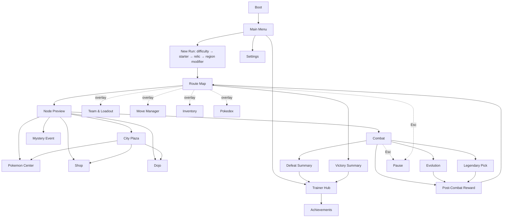

# Topic 9 — Presentation

> **Canon.** `§` numbers are an API cited from code and tests — never renumber or delete a section.
>
> **This topic owns:** the art direction, the colour and type system, the combat and map layouts, iconography, audio, accessibility and the screen inventory.
> **It does not own:** any rule the UI displays. Per-screen detail is in [`ui/screens.md`](ui/screens.md), tokens and components in [`ui/design-system.md`](ui/design-system.md), and rendered references in [`ui/mockups/`](ui/mockups/).

---

# §9.1 Visual style

## §9.1.1 The statement

**Modern illustrated 2D, warm.** Bright, cel-shaded creature-RPG art with depth from lighting rather than
perspective; deckbuilder UI minimalism — Slay the Spire's clarity over decoration.

**Tone.** Cheerful, warm and vibrant by default (Pillar 5). Each Region layers its own palette and lighting on
top without ever breaking the base: even the Volcanic Highlands is *intense and dramatic*, never grim.

**Two coordinated themes.**

| Theme | Where | Feel |
|---|---|---|
| **Warm-light front-end** | Menus, map, node services, management, run-end, meta | Cream surfaces, warm-brown ink — a Pokémon Center interior |
| **Warm-dim stage** | The combat screen only | Deep-plum surface, warm-cream ink — the lights go down for a fight |

Display font **Baloo 2** (rounded), body font **Nunito**. Iconography is a single-weight rounded line set.

## §9.1.2 Asset sizes

| Asset | Size | Notes |
|---|---|---|
| Battle sprite | ~96 × 96, animated | Front and back; scaled up in the stage |
| Portrait | 475 × 475 | Menus, detail panels, card owner avatars at 32 × 32 |
| Box icon | 68 × 56 | Lists and the Box |
| Move card art | 144 × 96 | Landscape, framed by the card chrome |
| Relic icon | 64 × 64 | Rarity-tinted border |
| Held Item icon | 32 × 32 | With an equipped-state overlay |
| Consumable icon | 48 × 48 | 64 × 96 when framed as a card |
| Backdrop | 1920 × 1080 | Calm centre and lower third, so UI sits over it |

## §9.1.3 Colour

### §9.1.3.1 Core tokens

**Warm-light front-end**

| Token | Hex | Use |
|---|---|---|
| `--surface-0` | `#FBF4E6` | Page background, cream |
| `--surface-1` | `#FFFDF8` | Cards, raised tiles |
| `--surface-2` | `#F3E7D0` | Panels, headers |
| `--ink-primary` | `#3A2E22` | Headings and key data, warm brown |
| `--ink-secondary` | `#6B5A45` | Body text |
| `--ink-muted` | `#A8967C` | Labels, disabled |
| `--border` | `#E4D4B5` | Card and panel borders |
| `--accent-action` | `#FFCB3D` | Primary buttons, playable glow, AP pips |
| `--brand-red` | `#E84C4C` | Brand mark, danger accents |
| `--accent-positive` | `#54D98A` | Heals, gains, XP |
| `--accent-negative` | `#FF6B6B` | Damage, costs, faint |
| `--accent-warning` | `#FF9F45` | Status, Trauma, can't-afford |

**Warm-dim stage** overrides two: `--surface-0` `#2A2230` (deep plum) and `--ink-primary` `#FFF6EC` (warm
cream). The accent tokens are shared.

> **A contrast rule that is load-bearing.** On the **warm-light** theme the four semantic accents all fail WCAG
> AA as running text — as low as 1.6:1. They may be used as a **fill** (with dark ink on top), an **icon tint**,
> or a **border, underline or glow** — never as the `color` of text. On the **warm-dim stage** they pass
> comfortably and may be used as text. A "can't afford" warning is therefore an amber left-border and icon with
> normal-coloured text, not amber text.

### §9.1.3.2 Type palette (15)

| Type | Hex | | Type | Hex |
|---|---|---|---|---|
| Normal | `#A8A878` | | Ground | `#E0C068` |
| Fire | `#F08030` | | Flying | `#A890F0` |
| Water | `#6890F0` | | Psychic | `#F85888` |
| Electric | `#F8D030` | | Bug | `#A8B820` |
| Grass | `#78C850` | | Rock | `#B8A038` |
| Ice | `#98D8D8` | | Ghost | `#705898` |
| Fighting | `#C03028` | | Dragon | `#7038F8` |
| Poison | `#A040A0` | | | |

Canonical hues, but rendered warm: even Ice and Water get a warm backing or a warm-tinted glow on the stage so
they sit inside the palette rather than fighting it.

**Colour is never the only channel.** Every type, status and rarity carries a glyph or a shape as well as a
hue — a requirement that exists for colour-blind players and pays off for everyone in a seven-card hand.

---

# §9.2 The combat screen

## §9.2.1 Layout — squad formation

```
┌──────────────────────────────────────────────────────────────────────┐
│ [≡] [⚑ Fight name] [Rule] [Field]   [≣ last log line ▾]   [Turn][Deck]│  top bar, 56px
├──────────────────────────────────────────────────────────────────────┤
│   (sprite)                        [trainer]            [intent]       │
│  [BENCH 1 plate]                  [◉◉●○○]               (sprite)      │
│                    [intent]                          [BENCH 1 plate]  │
│              (sprite)  · · · · · · · · · · ·  (sprite)                │
│   (sprite)                                             [intent]       │
│  [BENCH 2 plate] [★ LEAD plate]           [LEAD plate]  (sprite)      │
│   your formation, left           enemy, mirrored, right [BENCH 2 plate]│
├──────────────────────────────────────────────────────────────────────┤
│  (3)   [Card][Card][Card][Card][Card] │ [Bag 2/2]       [ End Turn ] │
│  AP                                                      [ Run ]     │
└──────────────────────────────────────────────────────────────────────┘
```

**One formation each side, and every Pokémon on the field is one card** (v0.9.16, the user's calls: "unificar
información… que salgan los 3 pokemons que tiene el player, y que su información esté en la animación", and then "la
animación encapsulada dentro de la carta, algo parecido a las cartas de los movimientos"): the move card's grammar —
the slot tag on its top edge, the condition on its corner, types, name and level on a dark head, **the animated sprite
in a window lit in its first type**, its HP under it. There is no separate portrait column and no separate enemy panel
column: what a Pokémon is and where it stands are read in one place.

- **Your formation sits left**: the **Lead forward**, in the column nearest the enemy, **centred between its
  bench** — Bench 1 above, Bench 2 below, close together — the whole side centred on the stage; the Lead's card
  gold-framed and crowned, the same size as the rest. All three show their back sprites — the series' triple-battle picture. A bench card's last
  row is its HP and its swap price; the hits coming at a Pokémon this turn hang off its card's edge, towards the enemy
  (§9.2.5). The whole card is the button: a swap, an ally target, a step-back choice, the card it takes.
- **The enemy's formation mirrors yours, and is named as yours**: its **Lead** forward (the column nearest you,
  centred, red-framed), **Bench 1** behind it high and **Bench 2** low — the same tags as your plates (v0.9.16, the
  user's call; the rules still call the two behind the Lead its supports, §5.6). Each is its intent chips above its
  card (one line each, so two fit a column at 720 p; a chip wider than the card widens its column, never running onto a
  neighbour's card) and the card; a wild card carries the catch pill inside, at the end
  of its HP row. **One grammar for one enemy or three** (user, 2026-09-30): a lone enemy is a Lead
  standing large; the held card's number sits on every plate it reaches, and the full breakdown opens only for the one
  aimed at. **Two on the field stand as if three did**: the Lead centred, the other in the upper place, the lower empty.
- **Who an enemy will hit is drawn** (v0.9.16, the user's "flechas… muy sutil", then "se ven muy poquito"): a
  dotted arrow with a dark edge from the edge of each enemy's card to the edge of the card its visible intent names —
  over the cards, so its head is always in sight and a bench enemy's arrow is not taken for its Lead's — in **the
  intent's colour, which its chip's edge shares**: red a hit, **blue a stat change** (a drop on you, a rise on itself;
  its glyph an arrow down or up, so it is a shape as well as a colour), violet a condition, green help for an ally (a
  heal, a Cover) — every slot for a Cleave, a second action fainter. The chip is still the reading:
  the arrow joins it to its target. A hidden intent draws none. **Resting on an enemy** brings its arrows forward and the
  rest back (its bubble opens to its side, never over its own chip); **resting on one of yours** — or focusing it —
  brings forward the arrows aimed at it. The arrows step back while a ball rocks.
- **The rival trainer stands behind its line-up**, in the far column, between its Bench 1 and Bench 2 (v0.9.16), with
  **its whole team at its feet as the series' small Poké Balls**: beaten grey and struck, on the field lit and ringed,
  still to come plain — who they are stays a surprise until they come out (§2.7.3).
- **A fight opens one ball at a time**: the enemy's Pokémon sent out one after another, then yours — the Lead, a moment
  later Bench 1, then Bench 2 — each popping out in its card's window.
- **Every Pokémon's card is one size**, yours and the enemy's, a Lead or a lone wild one — the Lead is told by its
  frame and crown, not by its scale (v0.9.16, the user's call) — and **the size comes from the stage's height**, so
  720 p and 1080 p hold the same picture, smaller or larger: the card is a set fraction of the stage tall (capped only
  where a 1440 p screen would make it absurd), its window follows, and the sprite in the window is drawn at the whole or
  half multiple nearest it, never more than a tenth past it (D9).
- **The catch pill** (wild only) sits inside the enemy card, at the end of its HP row, with the best ball's chance; pressing it opens the
  **ball picker** — every ball in the bag with its count and its own chance, a row to throw (§2.6.4.1). **While the ball
  rocks, the field holds** as it stood when it left the hand — a pack does not scatter before the click says it was
  caught — the intents and arrows step back, and the ball shows only its wobbles.
- **The hand tray runs along the bottom, in one row** (v0.9.15): the 5 skill cards in the middle, a divider and
  the **Bag** (its item count and the turn's uses left, 2/2; it opens every item carried, one card per kind with ×N),
  and End Turn with Run under it on the right; **the AP capsule docks over the hand, at the screen's centre** (§9.2.2.4).
- **The damage preview** opens in the open ground between the formations when a card is aimed at an enemy — the
  number on the plate is the decision, the box the breakdown. Against a group, **every plate carries the held card's
  own number** (and a KO flag), or a blue dashed **Out of reach** lock where a Melee card cannot land.

## §9.2.2 Zones

### §9.2.2.1 Top bar
Persistent and never collapsed. Left: the menu, then **one chip naming the fight** — its kind as an icon (paw,
trainer, star for an Elite, trophy for a Gym; the bubble says what the kind means) and its name, the trainer named
once (v0.9.15: it was three chips, two of them saying the trainer's name); a Gym Leader's rule chip (§5.9.5); the
active field badge (with the `🏠 Home Field` marker when the enemy owns it). Middle: **the battle log as a ticker** —
the last thing that happened on one line, the whole fight dropping down on a click (it used to sit on the arena
floor, and fell off the stage at 720 p; the arena is for the fight) — and, while a card or an item waits for its
target, **the gold hint** in its place ("Click an enemy to aim it…", Cancel): on the field it lay across the very
Pokémon being aimed at (v0.9.16). Right: the turn and the deck/discard counts.
Each chip shows its full text on hover or focus.

### §9.2.2.2 Player squad
Each of the three is a card (§9.2.1): the slot tag (and the **Lead crown**) on the top edge, the status condition on
the corner, type labels, name and level on the head, the animated back sprite in its window, an HP bar with a numeric
`cur / max` — **the part this turn's visible intents will take striped** (v0.9.16; the number is on the chip hung off the
card) — and a cyan shield segment when a shield is present, the stat-stage and Trauma chips on a row of their own,
and on a bench its **swap price** and what it would take as the Lead. The Lead stands forward, gold-framed and crowned; the
bench behind it, the same size. A slot an intent is aimed at glows red round its plate and keeps its own frame — your Lead stays gold, so it
never reads as the enemy's red Lead.

A **fainted** Pokémon keeps its place: its sprite gone, its plate dimmed and reading *Fainted*. It is never removed
from the screen — the player needs to see the shape of their team.

### §9.2.2.3 Enemy
Each is a card (§9.2.1) under its intent chips: its place tag (Lead in the enemy's deep red, Bench 1, Bench 2), the
status condition on the corner, type labels, name and level, the animated front sprite in its window, the HP bar with
**phase-threshold notches** for boss-tier enemies and a **Phase N/M** chip beside it — and, on the one a card is aimed
at (on every one, for an area card), the part that card would take, striped — and the stage, armour and Sturdy chips. Its tier (Wild, Trainer, Elite, Gym Leader) is in the plate's bubble, not printed on every plate. The sprite is
as much the target as the plate: a click on either aims the held card there.

### §9.2.2.4 Hand tray
One row (v0.9.15; the header row it replaced cost the hand 60 px at 720 p): the hand and the Bag in the middle, End
Turn and, in a run, Run under it on the right — the exit quieter than the plan. **The AP capsule** (v0.9.16) sits in
the middle of the screen, the user's call: docked at the bottom centre of the field, right over the hand it is spent
from and clear of both formations — the number beside a pill of cells, one per point, gold like a card's cost gem,
draining as you play, and **no bubble covers it** — a card's steps aside, still over its card — and it keeps its
place while its number reads a preview. Of a capsule that fills, a sphere that drains and a striped bar, the cells are the one you can
count at a glance. **While a card is under
the pointer** — hovered, dragged or held — the cells it would spend go striped and the number reads `3 → 1` (a free
card changes nothing, so shows nothing); a card you cannot afford shows the cells you are short in red. The Defensive discount chip sits beside it when it is live. The next swap's price is not repeated here: it is on
each bench card, where the swap is clicked, with the ladder in that card's bubble. A hand wider than its row — a
relic's sixth or seventh card, or a narrow screen — tucks each card under its neighbour by just enough to fit, never
pushing the Bag. The deck and discard counts live in the top bar.

## §9.2.3 The move card

The card's **frame is its move's type colour**, so a hand reads as a type spread at a glance; everything on it
sits in insets that stay legible on any type (v0.9.15, the user's "one of the ugliest parts of the art"):

| Part | What it shows |
|---|---|
| **Head** (dark) | The **AP cost as a gold gem** (a cost changed this turn — Paralysis, a rule — wears an amber ring and the foot says `was N`) and the name, with the whole width for it |
| **Window** (dark, lit in the type's colour) | **The move itself**: its pixel illustration at 2× on one 68-cell grid for the whole set (D9; `public/art/moves/`, lane in `docs/art/pipeline.md`) — and the **owner**, its box sprite at 1× bottom-left (its name is in the bubble), so five cards from three Pokémon read as five moves and three owners. The ×N chip top-left; the Mastery star and a Step arrow top-right |
| **Plate** (cream) | What it does (`describeMove`), two lines held open so a row's gems line up |
| **Foot** (dark) | Range and role glyphs, the **power** in a dashed pill (a dash for none), the type's own pixel label (FRLG) |

**Dragged, the card itself travels** (v0.9.16), from the drag's first move: it hangs under the pointer, its place in
the hand left faded and its bubble shut, and over a target it can take it shrinks, lights and lifts up and aside, so the
target's own card — its number, its HP — stays in sight. The ×N chip sits on the window's top-left: how the move's type lands on the enemy Lead, green up, dark down. The
whole card's explanation is its one bubble, and it names the role in words (Offensive · Defensive · Utility) — the
foot's second glyph, which is the card's own and not the TypeChart's sword and shield. **The same picture lands on
the target**: when a move hits, its illustration flashes over the Pokémon it struck at 3× for about half a second,
with the lunge — an enemy's moves on your Lead too; never under reduced motion. A hand bigger than five tucks each card
under its neighbour so the row keeps its width. An item card (the Bag, §3.5) is the same anatomy smaller and pill-soft —
cost gem and name, the item on a lit window, what it does on the plate — its frame coloured by what it does: a
ball red, medicine green, a battle item blue.

**The two ways a card can be unplayable are colour-separated on purpose:**

| State | Treatment |
|---|---|
| **Not enough AP** | An amber border, a warning glyph in the foot, the picture faded |
| **Out of position** (a Melee card whose owner is not the Lead; also asleep, frozen, sealed) | A dashed edge, the picture faded, and a **blue band across the window**: `Melee` in bold and `needs Lead` beneath |

Amber means AP. Blue means position. Neither card is ever hidden, and neither loses its words: the name, the cost, the
plate and the owner stay at full ink, because they are what you plan the swap or the next turn with (D5).

Full anatomy: [`ui/design-system.md`](ui/design-system.md).

## §9.2.4 The damage preview

Triggered by hovering or dragging a card onto a target, appearing beside that target. **Against a group it is
per target** (§5.6): while a card is hovered, selected or dragged, each enemy it can reach shows that card's own
number on its panel, each one it cannot shows the blue out-of-reach lock, and the full breakdown below opens for
the enemy the card points at (under the drag, or under the pointer once the card is selected). An area card
shows a number on every enemy — never one "each" figure. In a group the card's own corner prints the move's
**power**, outlined so it cannot pass for a hit. **Dragging** is by pointer (mouse, pen or finger): a pill with
the move's type label and name follows the pointer; a drop on an enemy aims the card there, a drop above the
hand plays a card that takes no enemy (or hits them all, or has only one to hit), anywhere else lets go; Escape
cancels. It always shows:

- the **final calculated damage**, large,
- the breakdown — base, STAB, type effectiveness, range, field, relic and item terms,
- the crit chance when it is non-zero,
- the status rider and its chance,
- a redundancy warning ("Already Burned"),
- and a **KO flag** when the hit would finish the target.

This is Pillar 1's single most important element. It calls the same function the simulation calls; a preview
that disagrees with the outcome is a bug, never a rounding difference.

## §9.2.5 Intent vocabulary

| Icon | Intent | Display |
|---|---|---|
| ⚔ | Attack | `⚔ 24 → Lead (Squirtle)` |
| ⚔🌐 | Cleave | `⚔ 18 → ALL SLOTS` |
| 🎯 | Backstrike | `🎯 22 → Bench-L (Charmander)` |
| ⬆ | Buff | `⬆ Atk +1` |
| 🛡 | Stall | `🛡 Def +1` |
| 💢 | Status | `💢 BURN → Lead` |
| ❓ | Unknown | `❓` **plus the kind glyph** — you know a Cleave is coming, not how hard |
| 👤+ | Call for help | `Call for Help → +Nidoran♀` — who will join, by name (§5.6.2) |

A Pokémon that **acts twice** (§5.6.1) shows its second intent as a second chip under the first, marked *Also*
with a dashed border; each has its own number and its own intent card.

The intent number **recomputes live** when the player swaps, because it is predicted against whoever now
occupies the slot. The v0.1 playtest identified this as the element that makes the swap decision legible; it is
not an optimisation, it is the feature.

**As Lead** (v0.8.6, the user's idea): every living bench Pokémon carries a small **−N** badge in its corner (its bubble says "as your Lead") whenever the
visible intents would land something on it at the Lead — the same dry run with it leading, so it is the number its
portrait would show after the swap (red, with KO, when it would faint). The intent card of a hit aimed at your Lead
lists the same hit on each of them ("If Squirtle led: 10"). Pillar 2: the swap is priced in HP before it is made.

**The number is the hit** (§5.2): the dry-run Resolution's, so it matches what lands. **An area intent prints no
number on its chip** (user, 2026-09-25): `Bulldoze → ALL` — every target takes its own damage (type, Defence,
ability, held item), so the numbers go on the portraits it will land on, one each. **No area hit ever shows one
number**, on either side. A single-target chip keeps its `· N dmg`, which is the same number as the chip on the
portrait it is aimed at. A Healer's or Buffer's intent names the ally it lands on (`Soft-Boiled → heals Geodude`).

## §9.2.6 The intent card

Resting on an intent chip (or focusing it) opens the **intent card** — the enemy side's counterpart to a move
card's bubble (user, 2026-09-25): the move, its type, its power and range; who it is aimed at (a slot and its
occupant, your whole side, or the ally it heals or raises); **the HP it takes off each Pokémon it lands on** and
whether that knocks it out (the forecast's numbers, the same as on the portraits); its riders (a status and its
chance, a stat change, a heal, recoil, drain); and its recharge. The kind's one-line counsel sits at the foot. A
hidden intent (§5.5) opens the kind and nothing more. The numbers stay on the screen; the card is the full read.

---

# §9.3 The map screen

```
┌────────────────────────────────────────────────────────────────────────┐
│ Region 1 · column 6 of 20      Brock (Rock) · Misty (Water)     ₽ ◓ 🎒  │
├──────────────────┬─────────────────────────────────────────────────────┤
│  Active Team     │ ◀ scroll ▶                                          │
│  [Lead ★] [B][B] │  🧢- - -🌿- - -?╲ - 🧢- -🌿- - (cave) - -🌿- - - 🧔    │
│                  │  ✓━━━🧢━━━◉┉┉┉🌿╳ - 🎒- -⚔- -┤                        │
│  Box             │  🌿- - -💊- - -🧢╱ - 🌿- -?- - (water, rain) - 🧢- 👧   │
│  ⚪ ⚪ ⚠2 ⚪ …    │  [ the whole route in a strip, your view outlined ] │
└──────────────────┴─────────────────────────────────────────────────────┘
```

The route runs **left to right**, the way a Pokémon route is walked, and it is wider than the screen: the graph
is a horizontal scroller over the painted terrain (§2.5.4), dragged, wheeled or keyed (arrows, Home/End), and the
view follows the player — it centres on where you stand after every node and on a node when you open its
preview. A strip under the graph shows the whole route at a glance with the visible window outlined; clicking it
jumps there. The vertical map was a roguelike convention borrowed from a game about climbing a tower; a route is
a road.

The terrain is drawn from tiles at whole-pixel scale, so the FRLG pixel stays crisp: open ground, the scenery
between the routes, each lane in its Gym's terrain, the point of no return as a river with a bridge under every line
that crosses it, and a lane's Battlefield drawn over it as weather (§2.5.4).

**The routes are lines, the nodes are the things themselves** (v0.9.14, the user's note after Pokelike's map: "es
bastante limpio, y la ruta que el jugador querría seguir queda bastante clara, ya que los iconos son bastante
representativos de lo que va a venir"). Every edge is one **straight line** from node to node — diagonal where the
route changes track — so a route reads as a line you can follow and two edges never share a stretch of road. (The
FireRed roads that turned at right angles before it made a node seem to lead wherever a neighbour's road did.) The
lines speak in four registers, each with a dark casing so it holds 3:1 on any ground: **the steps you can take now**
solid gold, marching toward where they lead; **the routes still open** from where you stand dashed cream; **the road
behind you** solid; **a route you can no longer take** a faint dotted trace.

A node is drawn as **what it is**, standing on its point with a shadow under it: a trainer is its class's sprite, the
Elite its trainer, a Gym its Leader at twice the size with a gold glow; a Wild Area the Pokémon you will meet most,
peeking out of the grass (or the water, on the sea and the river); the Elite Wild the Pokémon itself; the nurse and the
merchant themselves; a find the item lying there; a Mystery the overworld's "?". State reads through the picture —
full colour on every route still open from where you stand (`nodesAhead`), faded where you can no longer go,
darkened with a tick once cleared — and through a ring on the ground: pulsing gold where you stand, gold under the
nodes you can step to next, which also bob on their spot. Only the Gyms and the Elite carry a caption; any
other names itself under the pointer, and its bubble says the rest. The node's preview opens over the route dimmed
and softened, never over a black void, and wears the same picture as the node. The strip under the board draws
the routes and every node in miniature — a fight a filled dot, a stop a ring, the Gyms diamonds in their types'
colours — the walked road dark and the closed routes faded, so the whole Region's choice is one glance.

The left column is the Active Team (three tiles, the Lead crowned) above a scrollable Box. Trauma badges overlay
any portrait; fainted Pokémon are dimmed but still draggable, so you can prepare a post-nurse line-up.

---

# §9.4 Iconography

## §9.4.1 Node icons
Wild 🌿 (its biome's emblem) · Trainer 👤 (its archetype) · Elite Trainer 👤⭐ · Elite Wild 🦕 · Field nurse ❤️ ·
Merchant 🛒 · Mystery ❓ · Something on the ground ◓ (the item ball) · Gym 👑 · City 🏙️.

## §9.4.2 Resource icons
AP ● · Poké Dollar ₽ · Pokéball ◓ · Trainer XP ⭐ · Token 🪙 · Trauma ⚠ · Mastery 🏆.

## §9.4.3 Status icons

| Condition | Icon | Tint |
|---|---|---|
| Burn | 🔥 | Fire |
| Poison | ☠️ | Poison |
| Paralysis | ⚡ | Electric |
| Sleep | 💤 | Desaturated blue |
| Freeze | 🧊 | Ice |
| Confusion | 💫 | Yellow-magenta |

Every one carries a distinct glyph shape, so the row reads in grayscale.

## §9.4.4 Type charts

A type badge explains its matchups on hover, as a chart of the games' own type labels — one row per multiplier, its
value a coloured pill (v0.9.6). **Attacking and defending never read alike**, because the same ×2 is good news on your
move and bad news on your Pokémon:

| Where | Reads | Rows | Colours |
|---|---|---|---|
| A move's type (a card, the Move Manager, the Dojo) | ⚔ *When it hits* | ×2 · ×½ · ×0 | gold for ×2, a muted pill for ×½ |
| A Pokémon's types (a portrait, a panel, the Box) | 🛡 *When it is hit*, both types together | ×4 · ×2 · ×½ · ×¼ · ×0 | the reds for ×4 and ×2, the greens for ×½ and ×¼ |

×0 is grey on both. A damaging card's own tooltip carries its type's attacking chart, since hovering the card is how a
player reaches its type in a fight.

## §9.4.5 Progress after a fight

The reward screen (§3.5 in `ui/screens.md`) says what the fight gave as pills and chips, the words on hover: per
Pokémon, its XP and, on a level-up, the stats gained (old → new on hover), the moves learned (an outlined chip
"in the pool" past four), *Ready to evolve*, the Bond and what a Bond rank opened (the hidden ability as its own chip);
then what the fight moved on the account — each medal and Tier-2 discovery with its bar, *Done* when it completed —
and the loot as one strip. Progress made **outside** a fight (an evolution, a recruit, a run's end) shows in the
**progress panel**: a dark note in the bottom-left corner, one at a time for a few seconds, never taking a click, held
while a fight or its reward screen is up — a fight's own news is its reward screen's (v0.9.6).

---

# §9.5 Audio

## §9.5.1 Direction
Layered orchestral-electronic, themed per Region. Combat audio is multi-stem so it can follow the fight's
tension; map audio is ambient-forward. Every player action has feedback, every status has a motif, and bosses
get their own track.

## §9.5.2 Combat stems

| Stem | Trigger |
|---|---|
| `combat_base` | Always playing |
| `combat_low_hp` | Team total HP below 30 % |
| `combat_setup` | The first two turns of a boss fight |
| `combat_phase` | Boss Phase 2 or 3 |
| `combat_victory` / `combat_defeat` | Outcome stings |

Stems cross-fade over 250 ms.

## §9.5.3 SFX
Type-coded card whooshes (Fire crackles, Water splashes) · a soft chime for consumables · a confident step plus
chord for a manual swap · directional whooshes for Step-Forward and Step-Backward · a soft fall for a faint ·
type-coded status stings · a crystalline ping for a crit · a heavy layered impact for super-effective · a muted
thud for resisted · paper shuffle for draws · a solid bell for End Turn · rising tension then an orchestral hit
for a boss evolution.

## §9.5.4 Music
Region 1 light flute and strings with birdsong, ~110 BPM major · Region 2 brass, waves and tense strings,
~115 BPM minor · Region 3 percussion, brass and sub-bass, ~125 BPM modal minor · Cities a warm looped rest-hub
jingle · Victory Road sparse cinematic strings, ~85 BPM · each League member a unique track, the Champion a
three-phase dynamic composition.

## §9.5.5 Mix
Master −14 LUFS integrated, music −18, SFX −16 peak. Normalised at authoring time.

---

# §9.6 Accessibility

**Staged, not deferred to nothing.** The full suite was originally a launch requirement, then postponed
wholesale; both extremes were wrong. The two items that are expensive to retrofit come early, the rest follow
at polish.

| Item | Version | Why then |
|---|---|---|
| **Reduced motion** | v0.2 ✅ | Brought forward. Honours `prefers-reduced-motion`: the shake, lunge, deal and pop fallbacks are per-component, and a blanket rule caps *every* animation at one iteration so nothing pulses forever. One-shots keep running, because a `forwards` animation carries its element to a final state and killing it strands damage numbers mid-air |
| **Keyboard play** | v0.2 ✅ | Brought forward. The whole fight runs from the keyboard: 1–9 pick a card, E ends the turn, Escape cancels. Tab order still works; this is the fast path |
| **Screen-reader labelling** | v0.2 ✅ | Brought forward from post-v1.0. Every control carries a name, cards read as a sentence rather than a pile of glyphs, and a polite live region narrates the fight and the map. Asserted by `e2e/a11y.spec.ts`, so it cannot rot |
| **Focus management** | v0.2 ✅ | Every modal takes focus on open, cycles Tab inside itself, and hands focus back on close |
| **Text size** (80 / 100 / 125 / 150 %) | v0.5 | Layouts have to be built at 150 % from the start or they clip |
| Basic settings — audio, fullscreen, language | v0.1 ✅ | Shipped |
| Colour-blind palettes and pattern overlays | v1.1 | The shape-not-just-colour rule (§9.1.3.2) is already enforced, which is the hard half |
| SFX subtitles | v1.1 | Needs the audio pass first |
| Full key and pad rebinding, two profiles | v1.1 | |

The four brought forward were all cheaper to do now than to retrofit, and three of them are the kind of thing
that silently decays the moment nobody is checking. `e2e/a11y.spec.ts` is the check.

**Always true, from v0.1:** every hover has a focus and tap equivalent; nothing unplayable is hidden, only
marked; the damage preview is text as well as colour; pause is available mid-Action-Phase; flashes are capped at
photosensitivity-safe frequencies and disabled entirely under reduced motion.

## §9.6.1 Cognitive accessibility
A tutorial mode with longer telegraphs and slower pacing; an optional hint overlay suggesting a strong play,
off by default and with no penalty for using it; and a Pokédex study mode that previews an enemy's intent pool
against your current team's type matchups.

---

# §9.7 UI architecture

The UI is a **view**: it reads state, dispatches actions and computes nothing but formatting. It never owns
game state and never re-implements a rule — the damage preview calls the simulation, and playability comes from
the simulation as a boolean plus a reason.

Components are state-driven by class, styled from the design tokens of §9.1.3, and structured per screen in
[`ui/design-system.md`](ui/design-system.md). Every display string is localisation-ready with a namespaced
key; no literal English in a component.

> The per-screen specs in `ui/` name their data sources in Unity-era vocabulary — "channels" and "SOs". Read
> those as **store selectors and content lookups**; the binding *shape* is correct even where the noun is not.

---

# §9.8 Mobile

Not a launch target, but kept cheap: hit targets are at least 44 × 44, every hover has a tap equivalent,
tooltips can be tapped open, and layouts reflow from 4:3 to 21:9. A real mobile port is a roadmap item, not a
commitment.

---

# §9.9 Motion

| Element | Motion |
|---|---|
| **Pokémon** | 2-frame idle breath · 4-frame attack lunge · flash and recoil on damage · 3-frame faint fade · an 8-frame evolution sequence |
| **Cards** | Draw slides from the deck (200 ms) · play lifts, glows and fades toward the target (350 ms) · discard fades (150 ms) · the hand fans in |
| **Camera** | Locked in combat; a 1px shake on heavy hits · smooth pan on the map · a 1.5 s zoom and chord for a boss intro |

**The choreography principle:** anything the player must *read in order to decide* — an intent, a damage
preview, a catch gauge — appears **instantly and persistently**. Flourish animates; information does not.

Under reduced motion: bars jump, arrows and previews appear instantly, no parallax, no shake, no particles.
Damage numbers keep a 1.2 s hold and a fade, because persistence is what makes them readable.

## §9.9.1 The arena's beats

The series' own beats, drawn in the arena on top of a result the sim has already decided (v0.9.3):

| Beat | What the player sees |
|---|---|
| **Sent out** | A Poké Ball flies in an arc from the trainer's hand — the foe's trainer, or yours from off the left edge — lands, and pops open; the Pokémon whitens and grows out of a ring of light. The foes first, staggered, then your Lead. A wild one steps in from the grass instead. A trainer's next Pokémon, and a swap's new Lead, come out the same way. |
| **Recalled** | A swapped-out Lead turns red and shrinks into its ball, and the ball flies back to your hand. |
| **Fainted** | A fallen Pokémon holds a beat and flashes, then sinks through the ground line as it greys and fades out — gone by the last frame, never cut while it still shows, and it never fades back. A foe's card fades with it in its place, and the others hold theirs until it has gone (v0.9.11). A trainer's, or yours, then goes back into its ball, which flies back to the trainer's hand before the next one is thrown. A wild one simply goes. |
| **Evolution** | "What? Bulbasaur is evolving!" on a dark stage; the sprite turns to light, the old and the new shapes trade places faster and faster — never under 100 ms, both the same light, so a shape changes and not a screen's brightness — a bloom behind it, and the new Pokémon in its colours: "Congratulations! …". A click or a key skips it; it plays before the path is chosen when every path makes one species, after when they differ (v0.9.6). |
| **The catch** | The ball is thrown in a parabola — across at an even pace, up and down under gravity, its path never spun (v0.9.16: a rotated path swung it round in a loop), and never higher than the field has room for, so a Bench 1 at 720 p gets a flatter throw rather than a ball out of sight — opens on the Pokémon and draws it in, falls to the ground with a bounce, and rocks: a still moment, then a rock, once per shake check (§2.6.4.4) — three wobbles, a still moment, and the click with three sparks on a catch; on a break, the ball bursts open as the wobble its check followed ends, and the Pokémon is back in its card with the burst (v0.9.16: a still moment and a second's wait after it read as the beat stalling). The ball shows only its wobbles: the chance was on the pill before the throw (v0.9.16, the user's call: the lights under it went). "Gotcha!" or the series' line for how close it came lands with the click or the burst. About six and a half seconds for a catch, the series' pace; a break is over sooner. |

The beats are presentation only: the catch's result is rolled first (§2.6.4.1) and the ball only shows it. A beat
the player should not talk over — the catch and a faint — holds the hand, the keys and the outcome until it has played,
and the combat log keeps the catch's result back until the ball tells it; a Pokémon coming out never holds the hand, so
a fight can start at once. Their lengths are one table (`FX_MS`) that the timers and the keyframes both read. Under
reduced motion every beat is instant.

---

# §9.10 Localisation

Every user-facing string is a namespaced key (`ui.combat.end_turn`, `move.tackle.name`, `species.pidgey.name`),
never literal text in a component. Layouts tolerate **+40 % string length** and CJK line-breaking without
clipping; buttons hug their content with a minimum width. Numbers, dates and currency go through the formatter.

| Locale | Status |
|---|---|
| English (en-US) | Primary |
| Spanish (es-ES) | Planned for v1.1 |
| French, Japanese | Later; Japanese needs a CJK font |

---

# §9.11 Build order

| Surface | Version |
|---|---|
| Combat screen, scenario picker, main menu | v0.1 ✅ |
| Map, node preview, post-combat reward, team and loadout, starter select, victory, defeat, pause | v0.2 |
| Evolution, Move Manager, TM screen | v0.3 |
| Shop, Mystery Event, inventory | v0.4 |
| Legendary pick, Pokédex, achievements, settings expansion | v0.5–v0.6 |
| City plaza, Dojo, Grand Dojo, Black Market | v0.7 |
| Audio, the accessibility tier, localisation, generated backdrops | v1.1 |

---

# §9.12 The screen inventory

Twenty-seven screens, each with a written spec in [`ui/`](ui/) and a rendered mockup in
[`ui/mockups/`](ui/mockups/). Three are built.

## §9.12.1 Flow



## §9.12.2 Inventory

| Cluster | Screens |
|---|---|
| **Front-end** | Boot · Main Menu · Trainer Hub · Achievements · Settings |
| **New run** | Difficulty · Starter · Starting Relic · Region Modifier |
| **In run** | Route Map · Node Preview · **Combat** · Post-Combat Reward · Evolution · Legendary Pick |
| **Node services** | Pokémon Center · Shop · Dojo · City Plaza · Mystery Event |
| **Management** | Team & Loadout · Move Manager · Inventory · Pokédex |
| **Run end** | Victory · Defeat |
| **Overlay** | Pause · confirmation modal · toast · tooltip |

## §9.12.3 Notable decisions

- **New-run setup is reversible until the first node.** Confirming the Region Modifier locks the seed and
  generates the map, behind an explicit confirmation.
- **Team and loadout are Map-only** and lock on node entry. There is no mid-combat loadout.
- **The City is a top-down aerial town** with clickable buildings. Picking two closes the rest.
- **The Dojo always renders four move slots** plus the locked Mastery fifth; teaching is a choice of which slot
  to fill or overwrite, and Mastery is never a target.
- **Healing previews show before → after** on each team row: solid for current HP, hatched for the restoration.
- **Mystery choices show outcome tags** — gain, cost, risk. Never blind RNG (Pillar 1).
- **Defeat is warm, not punishing.** It shows how far you got and what you kept (Pillar 5).
